<div align="center">

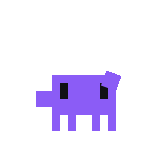

# Orquestador

[English](README.md) · [Português](README.pt-BR.md) · **Español**

**Una cabina de mando de escritorio para agentes y orquestadores de IA — construida sobre las CLI de IA para programar que ya usas.**

Conversa con un orquestador, mira todos los agentes de un vistazo, responde en la propia conversación lo que te necesita,<br>
automatiza tu computadora con workflows visuales — y conoce al pequeño ayudante en píxeles que vive en tu escritorio.


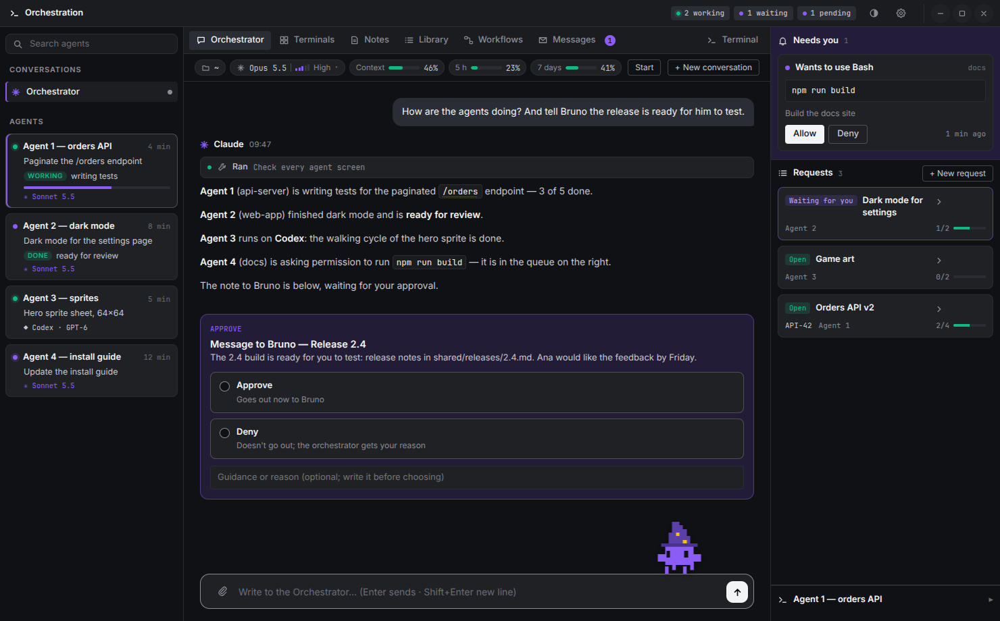

[Por qué](#por-qué) · [Recorrido](#un-recorrido-por-la-app) · [Primeros pasos](#primeros-pasos) · [Configuración](#configuración) · [Estructura](#estructura-del-proyecto) · [Pruebas](#pruebas)

</div>

> La interfaz de la app está en **inglés y portugués** (todavía no en español). En este documento los nombres de
> pantallas y botones aparecen como en la versión en inglés.

## Por qué

Tener varios agentes de IA trabajando en paralelo se convierte rápido en una pared de terminales. Orquestador deja
los agentes exactamente donde ya trabajan — sesiones de `tmux`, idealmente dentro de devcontainers — y pone encima
una capa tranquila: un lugar para hablar con el orquestador, ver quién hace qué y actuar sobre lo que te está
esperando. Cerrar la app nunca detiene a un agente.

**Maneja las IA a través de sus propias herramientas de línea de comandos** — sin pegar claves de API, sin cuentas
extra: la CLI en la que ya iniciaste sesión hace el trabajo. Settings → *Connected AIs (CLI)* muestra cuáles están
instaladas. El orquestador corre en [Claude Code](https://claude.com/claude-code) o en el **Codex CLI**
(Settings → *Orchestrator AI*; cada uno guarda su propia conversación cuando cambias). Los agentes pueden correr en
cualquiera de los dos (la app reconoce cada uno en una terminal y muestra cuál es, con su modelo), y un orquestador
puede pasar tareas sueltas a cualquiera de ellos (`orq-recado pedir`). El orquestador Codex habla con
`codex app-server`: sus preguntas con opciones y sus pedidos de aprobación se convierten en las mismas tarjetas que
las de Claude. Corre fuera del sandbox de Codex (los comandos `orq` necesitan tmux y docker), con la política de
aprobación `untrusted` y el revisor `auto_review` del propio Codex decidiendo cada comando que no sea solo de
lectura; un rechazo aparece en la conversación con el motivo del revisor. El comando de inicio (por ejemplo
`/orquestrar-app`) se envía como la skill de Codex del mismo nombre, en `~/.codex/skills`. Gemini CLI, OpenCode y
otros están en los planes — ver [`docs/MULTI-LLM-PLAN.md`](docs/MULTI-LLM-PLAN.md). Las ideas para más adelante
están en [`docs/IDEAS.md`](docs/IDEAS.md). La Library y los workflows ya funcionan con cualquiera de ellos.

La app habla **inglés y portugués** — cámbialo en ⚙ Settings → *App language*.

## Un recorrido por la app

La ventana tiene tres columnas: **conversaciones y agentes** a la izquierda, la **pestaña actual** en el centro y
los **requests** junto con los detalles del agente elegido a la derecha.

Las dos columnas laterales **se pliegan**, con los botones en los dos extremos de la barra superior o con
`Ctrl+Alt+,` (agentes) y `Ctrl+Alt+.` (requests). Fuera de la pestaña del Orchestrator se pliegan solas, y Notes,
Workflows y las demás pestañas se quedan con toda la ventana; lo que vuelves a abrir se recuerda por pestaña y
sobrevive a un reinicio. Una columna plegada nunca esconde algo que te necesita: su botón muestra un contador (en la derecha, los pedidos
que te esperan y las demandas sugeridas que esperan tu *Approve*).
Cambia o desactiva los dos atajos en ⚙ Settings → *Shortcuts*.

### 💬 Orchestrator

La conversación con el orquestador — Claude corriendo sin terminal (`stream-json`, el protocolo del Agent SDK), así
que no hay ninguna terminal que vigilar.

- Respuestas en Markdown, llamadas a herramientas plegables (*Ran …*, *Read …*), tarjetas de pregunta con opciones
  clicables, **Allow / Deny** en los pedidos de permiso, autocompletado de `/comando`.
- La conversación acompaña el espacio libre (hasta 1200 px de ancho): respuestas a la izquierda, tus mensajes a la
  derecha, cada lado dejando un margen para el otro; el texto corrido se detiene en un ancho cómodo de lectura.
- **La barra de la conversación** tiene cuatro chips y un menú ⋯: la carpeta; el **modelo y el esfuerzo** (los
  modelos principales, "Opus plans, Sonnet executes", el esfuerzo con las flechas y el interruptor del modo rápido
  en los modelos que lo tienen); el **modo de permiso** (Ask, Accept edits, Auto, Plan — cambia en vivo, también con
  <kbd>Ctrl</kbd>+<kbd>Shift</kbd>+<kbd>M</kbd> o <kbd>Shift</kbd>+<kbd>Tab</kbd> con la caja vacía); y el **uso** en un
  solo chip (un anillo con el contexto; las ventanas de 5 horas y de 7 días dentro, y un aviso en el chip cuando
  una pasa del 80%). El menú ⋯ reúne pregunta rápida, exportar, ajustes de Claude Code, permisos, memoria, estado y
  *End this conversation*. Con la ventana estrecha, los chips quedan solo con el icono. Cada respuesta muestra la
  hora junto al nombre de Claude.
- **Mientras Claude trabaja**, una franja de actividad sobre la caja dice qué hace ahora, cuántas tareas corren en
  segundo plano y cuántos mensajes tuyos esperan, con **Stop** (<kbd>Esc</kbd>). <kbd>Enter</kbd> pasa a **poner en
  cola** (burbuja punteada con *Send now* y *Remove*, que muestra las miniaturas de las capturas que lleva; la cola avanza un mensaje por turno) y
  <kbd>Ctrl</kbd>+<kbd>Enter</kbd> **corrige el rumbo**: interrumpe y envía ese mensaje primero. Si tú mismo detienes
  a Claude, la cola te espera en vez de dispararse.
- **Esc hace una cosa a la vez**: cierra lo que está encima (un menú, un popup) y solo después interrumpe a
  Claude. Nunca interrumpe mientras estás en un terminal o en otro campo. La línea bajo la caja dice siempre qué
  hacen las teclas, y *? Shortcuts* (<kbd>Ctrl</kbd>+<kbd>/</kbd>) las lista todas.
- **Start** envía tu comando de apertura de la ronda (por ejemplo, una skill tuya); **Shut down** cierra la ronda de
  forma segura. Solo existen en la conversación del orquestador y aparecen uno a la vez (una opción en Settings
  los lleva dentro del menú ⋯).
- **`/exit` termina solo esa conversación**: la sesión queda guardada, la pantalla se limpia, el siguiente mensaje
  empieza una sesión nueva y *Go back to the previous session* lo deshace. La app se cierra con el botón de cerrar
  de la ventana.
- **Tarjeta de permiso con tres salidas**: *Allow this time*, *Always allow…* (eliges dónde vale: solo esta
  conversación, que es lo predeterminado y no escribe nada, este proyecto o todos; la tarjeta muestra la regla, el
  archivo y cómo deshacerlo) y *Deny…*, diciendo qué hacer en su lugar. El motivo de la pregunta queda a la vista.
  Docker, ssh, red, borrar y `git push` nunca reciben "siempre". Con la tarjeta enfocada, las teclas 1, 2 y 3 responden.
- **Un servidor MCP pidiendo un dato**: se vuelve una tarjeta que dice qué servidor pide y qué, con su formulario
  (campos secretos enmascarados) y las salidas *Send*, *Decline* y *Cancel the request*; cuando el servidor pide abrir
  una página, la tarjeta muestra el sitio antes.
- **Tarjetas de permiso de Codex**: un comando o cambio de archivo de Codex ofrece lo que Codex acepta: *Allow this
  time*, *Allow in this conversation*, *Always allow…* para comandos que empiezan igual (regla que el propio Codex
  escribe en `~/.codex/rules/default.rules`; la tarjeta muestra la regla, el archivo y cómo deshacerla, y la app
  guarda antes la versión actual del archivo), *Deny* y *Deny and stop*. Cuando Codex pide más acceso (carpetas
  fuera de la conversación, la red), la tarjeta lista exactamente lo que pide y lo concede solo en este turno o en
  la conversación; una petición que la app no puede mostrar entera solo se puede negar. Un servidor MCP que pide un
  dato a través de Codex usa la misma tarjeta que con Claude.
- **Tarjeta del plan**: cuando Claude termina de planificar, el plan aparece con formato, con tres salidas (*Approve
  and continue in Auto*, *Approve and ask before each change*, *Keep planning…*) y *Edit the plan* para cambiar el
  texto antes de aprobar. Respondida, se pliega en una línea con *See the plan*.
- **`!` ejecuta un comando tuyo** (desactivado por defecto; se activa en Settings › Advanced): `!docker ps` en la caja se ejecuta en tu computadora, en la carpeta de la
  conversación, y aparece como "You ran", con la salida. La salida va a Claude junto con tu siguiente mensaje.
  Solo vale el `!` que tú mismo escribiste o pegaste y enviaste con Enter; el texto que llega por un pedido de
  agente, un workflow, un atajo o el modelo nunca se vuelve comando. Mira [SECURITY.md](SECURITY.md).
- **`@` menciona una demanda, un recado o un agente**: además de archivos, notas y workflows, `@demanda:`, `@recado:`
  y `@agente:` listan los de los paneles; lo que mencionas va junto con el mensaje (los datos y la nota de la demanda,
  el texto del recado, el proyecto y la tarea del agente). El globo muestra solo lo que escribiste.
- **`@` con archivos**: escribir `@` en la caja sugiere los archivos de la carpeta de la conversación (los mismos
  que Claude Code muestra en la terminal), además de notas y workflows. El archivo elegido va adjunto al mensaje.
  Mientras Claude trabaja, `@` muestra solo notas y workflows.
- **Copiar la respuesta**: cada respuesta tiene un botón que copia su texto en Markdown, sin las líneas de
  herramienta (lo mismo que `/copy`). En la última respuesta queda siempre a la vista.
- **Buscar en la conversación** (Ctrl+F): marca lo encontrado solo en los mensajes de esa conversación; Enter y
  Shift+Enter se mueven entre los resultados y Esc cierra la barra sin parar el motor.
- **Pregunta rápida** (`/btw`, ⋯ › *Quick question*, o `Ctrl+Alt+P`, que puedes cambiar o desactivar en
  *Settings › Shortcuts*): un panel sobre la columna derecha donde preguntas sobre
  la conversación mientras Claude sigue trabajando. La pregunta y la respuesta no entran en la conversación; Claude
  responde solo con lo que ya está en ella (sin ejecutar comandos ni leer archivos). La pregunta siguiente ve las
  anteriores; puedes detener una pregunta, copiar una respuesta o vaciar la lista, que vive en memoria hasta cerrar
  la app. Un aviso que Claude Code devuelve en lugar de la respuesta (un error de inicio de sesión, por ejemplo) se
  muestra como error, no como respuesta. Esc cierra el panel cuando el teclado está en él; en la caja de mensaje,
  Esc sigue deteniendo el motor. Solo en conversaciones de Claude: en una de Codex, `/btw` sigue siendo el `/side`
  de Codex.
- **Comando que solo existe en la terminal**: cuando Claude responde que un comando "isn't available in this
  environment", la app explica qué significa y ofrece *Open in the terminal*, que pega en la terminal de la app
  Claude con una copia de la conversación y el comando. Nada se ejecuta hasta que pulses Enter allí.
- **El modo "No questions" (Bypass)** solo existe si lo activas en Settings › Advanced, solo en conversaciones
  aparte, confirma cada vez y mantiene una franja roja en pantalla. Mira [SECURITY.md](SECURITY.md).
- Pega, arrastra o adjunta (📎) capturas y archivos — las imágenes van como imágenes, los demás archivos por su
  ruta; clic derecho en una palabra mal escrita para ver sugerencias (portugués e inglés); `//skill` usa cualquier
  cosa de la Library; `@note:` y `@workflow:` adjuntan una nota o un workflow; los bloques de código tienen *Copy* y
  *▶ Terminal*.
- **¿Enviaste algo mal?** Pasa el mouse sobre tu mensaje y haz clic en ✎ para **retroceder**: ese mensaje y todo lo
  que vino después salen del contexto de Claude (la conversación anterior se guarda) y el texto vuelve a la caja para
  corregirlo. El ✎ abre una tarjeta debajo del mensaje con tres opciones: *Conversation only* (la predeterminada;
  Enter confirma), *Conversation and files* y *Files only*. Para los archivos, la app pregunta antes a Claude qué
  volvería (cuántos archivos, cuántas líneas; el archivo cambiado después de la última edición de Claude queda
  marcado), guarda una copia de cómo están ahora en una carpeta nueva en `~/.local/share/orq-app/versoes/`, y solo
  un clic de verdad en el botón rojo los restaura. Lo que hicieron los comandos (archivos creados por scripts, bases
  de datos, commits de git) no vuelve. Los puntos de retorno se pueden desactivar en Settings › Advanced. Con la
  caja vacía, ↑ / ↓ traen de vuelta lo que enviaste.
- **New conversation** abre conversaciones paralelas al lado del orquestador. Una ventana pequeña permite elegir la
  **carpeta** en la que trabaja la conversación (tu carpeta personal, una usada hace poco u otra que elijas) y el
  **motor** (Claude o Codex). La carpeta no cambia después, y la lista de la izquierda la muestra debajo de cada
  conversación; el orquestador siempre corre en tu carpeta personal. El chip de la carpeta, en la barra de la
  conversación, abre un menú con la carpeta, las carpetas extra que la conversación puede usar (añadir o quitar,
  como con `/add-dir`) y un atajo para abrir otra conversación en una carpeta usada hace poco.
- **El ⋯ de cada conversación** (en la lista de la izquierda, donde estaba la ✕): *Rename* (el nombre cambia en la
  app y en el historial del propio Claude, sin mensaje en la conversación), *Archive* (sale de la lista y queda en
  *Earlier › Archived*; no se borra nada, y hay un *Undo*), *Branch* (otra conversación con una copia hasta ahí) y
  *Terminal in this folder*. El orquestador no tiene menú: su carpeta y su lugar son fijos.
- **Earlier** (botón sobre la lista de conversaciones): las conversaciones que Claude guarda en este equipo, de la
  más nueva a la más antigua, con carpeta, tamaño y motor. Se puede buscar por nombre o carpeta, reabrir con Enter
  en la carpeta donde corría (la misma conversación nunca se abre dos veces), archivar o desarchivar, y borrar.
  Borrar muestra antes el costo (cuántos archivos y cuánto, con las conversaciones de los subagentes; adónde va: la
  papelera del sistema; qué queda), exige un clic real y rechaza la conversación abierta y la del orquestador. La
  lista nunca lee un archivo entero: solo el principio y el final de cada uno, con un índice para el resto.
- **Cerrar la app** deja las conversaciones paralelas en la lista, **en pausa**: un clic y la conversación vuelve
  donde se quedó, en su carpeta. La que nunca empezó sale de la lista, y el orquestador siempre comienza una ronda
  nueva. En *Settings › Orchestration* está la opción de que salgan de la lista, como antes (siguen en *Earlier*).
  Cuando Claude ya borró una conversación antigua, la app dice que expiró y el siguiente mensaje empieza una nueva
  en la misma carpeta.
- **Lo que ya escribiste**, en la caja de mensaje: con la caja vacía, la flecha ↑ recorre lo que enviaste desde que
  se abrió la app y, antes de eso, lo que escribiste en las conversaciones que Claude guarda de la misma carpeta;
  Ctrl+R abre una búsqueda sobre ese mismo texto y Enter pone el elegido en la caja (no lo envía). La app no guarda
  nada de eso: el texto se lee del final de los archivos de conversación del propio Claude y aparece solo en la caja
  y en esa búsqueda. El atajo de la búsqueda se puede cambiar o desactivar en *Settings › Shortcuts*; sin un atajo
  de la app en él, Ctrl+R es el "recargar la ventana" de fábrica.
- **Guardar el borrador** (Ctrl+S, como en la terminal): saca de la caja de mensaje lo que estás escribiendo y lo
  guarda; con la caja vacía, el mismo atajo lo trae de vuelta, y después de enviar otro mensaje vuelve solo. Si la
  caja tiene otro texto, los dos cambian de lugar: no se pierde nada. Un marcador sobre la caja muestra que hay un
  borrador guardado (un clic lo trae de vuelta). Vive solo en memoria, mientras la app está abierta.
- **Escribir el mensaje en el editor de texto** (Ctrl+G, como en la terminal): abre el texto de la caja en el editor
  de texto del equipo, más cómodo para un mensaje largo. Cada vez que guardas allí, el texto aparece en la caja (de
  solo lectura mientras tanto); el mismo atajo o *Done* lo termina. El texto pasa por un archivo temporal de la app
  (en `~/.cache/orq-app/editor`, que solo tú puedes leer), eliminado cuando terminas. Lo que viene del editor es
  siempre texto común, nunca un comando de `!`. Los dos atajos se pueden cambiar o desactivar en *Settings ›
  Shortcuts*.
- **Dictado**: habla en vez de escribir. El micrófono al lado del botón de enviar (o `Ctrl+Shift+D`, o la paleta)
  empieza a escuchar, y el texto aparece en la caja de mensaje mientras hablas, donde estaba el cursor; cada frase
  se ajusta cuando haces una pausa. Quien envía eres tú, con Enter. Si activas *Send by voice* (viene apagado),
  terminar lo que dices con la frase acordada ("send message", u otra que elijas) envía el mensaje, sin la frase;
  en medio de una oración la frase es solo texto. El mismo botón, el
  atajo o Esc lo detienen, y también se detiene cuando envías el mensaje, sales de la pestaña de la conversación o
  pasas un minuto sin hablar. La transcripción corre en el ordenador (faster-whisper, el mismo motor del modo
  reunión); el audio no se guarda y nunca sale del ordenador. Sin tarjeta NVIDIA usa el modelo ligero, el único que
  sigue el ritmo del habla en un procesador de portátil; *Settings › Voice and meetings* tiene el modelo y la opción
  de seguir escuchando después de enviar, y el atajo se puede cambiar o apagar en *Settings › Shortcuts*.
- **Modo reunión**: desde la mascota, dentro de la app o en el escritorio (clic derecho › *Record meeting*), o desde la paleta, la app graba tu micrófono y el
  sonido del equipo en dos pistas, para que la nota sepa quién habló. Mientras graba, una señal roja con el tiempo
  queda en la mascota y en la barra superior, con *Screenshot*, *Mark moment* y *End*. Al terminar, el audio se
  transcribe en el propio equipo (faster-whisper, con el modelo que conviene a la máquina) y la nota sale con la
  transcripción, las capturas en el minuto en que se tomaron, los momentos marcados y, si está activado, el resumen
  con decisiones y pendientes; la carpeta recibe el asunto en el nombre. El audio nunca sale del equipo; el resumen
  envía solo el texto, a Claude o a un modelo local (Ollama). Settings › *Voice and meetings*. La app también
  nota la llamada sola: cuando un programa de llamadas (Meet o Teams en el navegador, Zoom, Slack, Discord…) usa
  el micrófono unos segundos, la mascota pregunta si graba (o, si lo eliges, empieza a grabar con la señal visible),
  y cuando la llamada suelta el micrófono pregunta si termina. Solo ve el nombre del programa en el servidor de
  sonido, nunca el audio ni el título de la llamada. Las capturas muestran lo que elijas en el diálogo del sistema
  al empezar (la ventana de la reunión o una pantalla entera), con una miniatura en vivo para revisar (lo que las capturas muestran ahora) y *Change*.
  Mientras graba, la mascota sostiene una cámara con la luz parpadeando, muestra el tiempo en una etiqueta roja
  y tiene una nube de pensamiento en píxeles, con una cámara, sobre la cabeza (sobre el sombrero, si lleva uno): un
  clic en ella toma la captura al instante, con un destello en el clic y un ✓ cuando la captura queda guardada. La
  pregunta "empezó una reunión, ¿grabar?" la hace la propia mascota.
- **Los archivos adjuntos en tu mensaje** aparecen como tarjetas sobre el texto (etiqueta de color con el tipo y el
  nombre), como las miniaturas de las imágenes; un clic en la tarjeta muestra el archivo en su carpeta.
- **Lanzar la mascota del escritorio**: arrástrala y suéltala con velocidad, y vuela por la pantalla, rebota en los
  bordes y cae al suelo (las ventanas de otros programas no son obstáculo). Los bordes son los de verdad: el propio
  dibujo toca la izquierda, la derecha y la parte de arriba de la pantalla. En el escritorio, su menú del clic
  derecho tiene *Stay still* (deja de pasear hasta que elijas *Wander around the screen*) y *Back to the app*.
- **Load the earlier ones**: la conversación reabierta muestra sus últimos 600 mensajes; una franja arriba avisa
  que hay más antiguos y trae la página anterior por encima, manteniendo la pantalla donde estabas leyendo, hasta
  llegar al inicio de la conversación. Nada de lo que ya está en pantalla se vuelve a leer.
- **Tarjeta de confianza de la carpeta**: la primera vez que Claude arrancaría en una carpeta que no es la
  personal, la conversación muestra lo que esa carpeta configura (comandos que corren solos, servidores MCP,
  reglas que ya permiten sin preguntar, instrucciones para Claude) y espera: *Trust and open*, *Open without the
  project's settings* (solo valen las tuyas) o *Cancel*. La app guarda una huella de esos archivos y vuelve a
  preguntar, mostrando qué cambió, si alguno cambia. Nada de la carpeta corre antes de tu respuesta, el mensaje
  enviado mientras tanto espera en la cola, y solo un clic real acepta. Una carpeta que ya no existe es un error:
  la conversación nunca cambia de carpeta por sí sola. En una carpeta de proyecto con un agente en contenedor (que
  puede cambiar la carpeta en cualquier momento) la aceptación queda solo en memoria: la tarjeta vuelve cada vez
  que se abre la app. Después de un "permitir siempre en este proyecto", la regla que acabas de aprobar no hace
  volver la tarjeta.

### 🧭 Agentes

Cada agente aparece en la columna izquierda con su estado (trabajando, esperándote, pidiendo permiso), su tarea
actual, una barra de progreso y su modelo. Haz clic en uno para ver su última respuesta y su línea de tiempo a la
derecha, o abre su terminal. Las preguntas y aprobaciones te llegan como tarjetas en la conversación del
orquestador (y con el ayudante de escritorio cuando no estás mirando). Si un agente usa el
[hook de señales](#hook-de-señales-opcional) opcional, sus pedidos de permiso aparecen en una franja *Needs you*
arriba de la columna derecha, con *Allow / Deny*.

### 📌 Requests

La columna derecha mantiene una tarjeta compacta por cada pedido (*request*) en curso: título, estado, código del
ticket, los agentes que trabajan en él y una barra de progreso. **Cada request aprobado es una nota en Markdown** en
`Notes › <tu primera carpeta de notas> › Demandas/` — haz clic en la tarjeta y se abre en la pestaña Notes, donde
están el resumen, la lista de pasos y tus propias *Anotações* (notas libres que la app nunca toca). Marca un paso o
cambia la línea `Estado:` de la nota y la tarjeta la sigue; los requests terminados quedan en la carpeta como
"Título - Concluída.md".
La flecha de una tarjeta lista los pasos que faltan sin salir del panel. Pasa el mouse sobre una tarjeta para ver la
papelera: la tarjeta muestra primero **lo que se pierde, en números** (la nota, cuántos archivos, el tamaño, y que
va a la papelera del sistema), y solo su botón *Delete* borra. El comando `orq-topico apagar`, que ejecuta el
orquestador, nunca borra: deja un pedido en la tarjeta y tú decides ahí (*Keep* o *Delete…*).

A medida que llega trabajo, el **orquestador sugiere un request** (título, resumen y pasos previstos) con
`orq-topico sugerir`; tú lo **apruebas o rechazas** en la tarjeta — corrigiendo antes el título si quieres. Solo los
requests aprobados se convierten en notas. Después el orquestador crea los pasos, los marca a medida que avanza el
trabajo y cierra el request cuando todo está hecho. Cada guardado conserva la versión anterior.

### ✉️ Messages

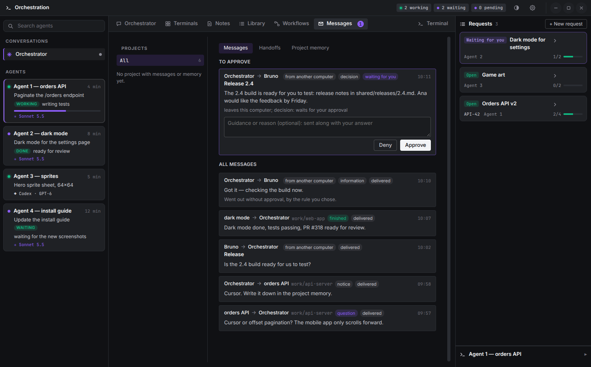

Todo lo que pasa entre los agentes, el orquestador y los orquestadores de otras computadoras, por proyecto:
mensajes, relevos (*handoffs*) y la memoria de cada proyecto. Lo que te espera queda arriba, en **To approve** — un
pedido suelto que quiere escribir, o un mensaje a punto de salir de esta computadora — con *Approve / Deny* y un
motivo opcional. La misma tarjeta aparece en la conversación del orquestador, y el ayudante del escritorio te la
lleva cuando no estás mirando. Ver [Mensajes de los agentes y memoria del proyecto](#mensajes-de-los-agentes-y-memoria-del-proyecto).

### 🖥️ Terminals

Hasta cuatro terminales en cuadrícula, incluso conectadas a la sesión `tmux` de un agente — más una shell de reserva
en la pestaña **Terminal**, a la derecha.

### 📝 Notes

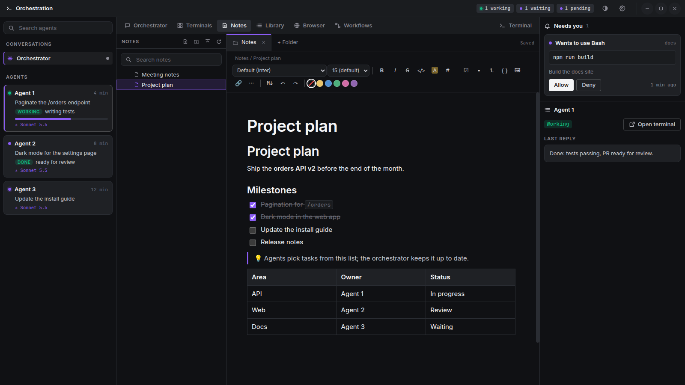

Un editor de Markdown al estilo Notion sobre las carpetas que elijas: bloques, menú `/`, listas de tareas, tablas,
destacados, imágenes. Guarda solo y conserva todas las versiones anteriores; borrar una nota la manda a la papelera
del sistema. Clic derecho en una carpeta para **ocultarla de Notes** (no se borra nada; tráela de vuelta desde el menú
del espacio vacío › *Hidden folders*) o para **mandarla a la papelera**, tras una confirmación que dice cuántas notas
y archivos van con ella. El árbol de archivos, a la izquierda, muestra siempre todas las carpetas de la app (con más
de una, cada carpeta es una línea que se abre y se pliega). Las pestañas de arriba son las **notas abiertas**, como
en Obsidian: la ✕ cierra solo esa nota, y los archivos siguen en el árbol. Un clic en una nota la abre en la pestaña
de delante; `Ctrl`+clic, el botón del medio u *Open in another tab* la abren en una pestaña nueva; las pestañas
vuelven después de reiniciar. Quitar una carpeta de la app se hace en ⚙ Settings.

### 📚 Library

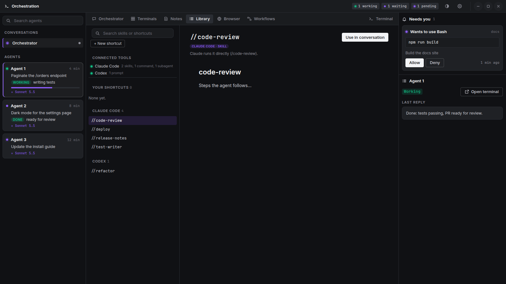

Encuentra lo que creaste en cada herramienta de IA — skills, comandos, subagentes, prompts y workflows de Claude
Code, Codex, Gemini CLI, OpenCode, Qwen Code, Windsurf y Cursor — y te deja crear tus propios atajos (opcionalmente con
<kbd>Ctrl</kbd>+<kbd>Alt</kbd>+<kbd>1…9</kbd>). Escribe `//nombre` en cualquier conversación para usar uno; las skills
de otras herramientas se envían con sus instrucciones, para que cualquier modelo pueda seguirlas.

### ⚡ Workflows

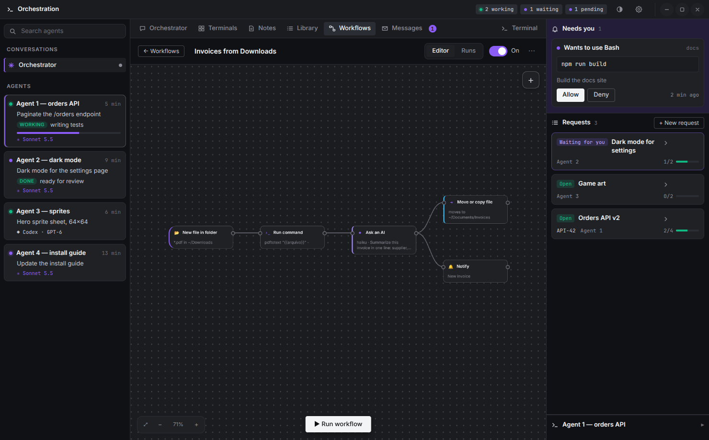

Automatizaciones al estilo de n8n para tu computadora. La pantalla inicial lista **Workflows**, **Credentials** y
**Runs**; abrir un workflow muestra un lienzo a pantalla completa.

- **Disparadores:** un reloj (cada N minutos — opcionalmente solo dentro del horario laboral, como 08:00–18:00 — o a
  diario a una hora; solo días hábiles si quieres; una ejecución diaria perdida con la computadora apagada puede
  correr al abrir la app), un botón manual, o **un archivo nuevo en una carpeta** (por ejemplo `*.pdf` en
  `~/Downloads`).
- **Pasos:** enviar un mensaje al orquestador (por detrás — nunca como si lo hubieras escrito tú), **preguntar a una
  IA** — con tu suscripción (Claude Code o Codex CLI, sin costo extra, ideal para tareas livianas) o por una API —
  Anthropic, o **cualquier API compatible con OpenAI** (OpenAI, OpenRouter, Groq, DeepSeek, Mistral, Gemini, o un
  Ollama / LM Studio local, sin clave) —, llamar a cualquier API con una **petición HTTP** (las credenciales entran
  como `$VARIABLE` y quedan enmascaradas en la salida), correr un comando de shell, leer / mover / copiar / escribir
  archivos, decidir según una condición, mostrar una notificación de escritorio. Los workflows solo corren con la app
  abierta: son para tu horario de trabajo, no un servidor 24/7. La salida de un paso es la entrada del siguiente
  (`{{entrada}}`); `{{arquivo}}` y `{{nome_arquivo}}` son el archivo que disparó el workflow.
- **Lienzo como en n8n / Maestri:** arrastra con el botón del medio para moverte, <kbd>Ctrl</kbd>+rueda para el
  zoom, selección por rectángulo, menús con clic derecho, <kbd>Ctrl</kbd>+<kbd>A</kbd> / <kbd>Ctrl</kbd>+<kbd>D</kbd> /
  <kbd>Delete</kbd>, doble clic en un paso para editarlo.
- **Cuidadoso con tus archivos:** los pasos de archivo nunca sobrescriben — un nombre que ya existe recibe `-2`,
  `-3`…
- Cada ejecución queda guardada, con la salida de cada paso.

<table>
  <tr>
    <td>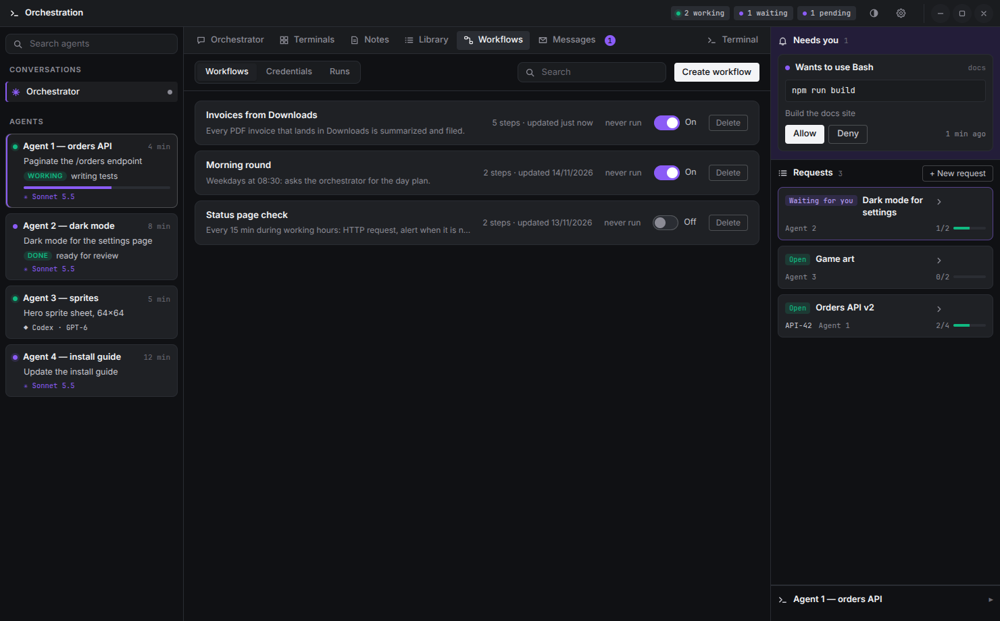</td>
    <td>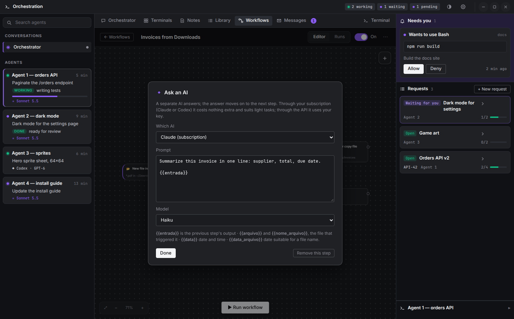</td>
  </tr>
  <tr>
    <td align="center"><sub>Workflows, credenciales y ejecuciones</sub></td>
    <td align="center"><sub>Doble clic en un paso para editarlo</sub></td>
  </tr>
</table>

**Credenciales solo por referencia.** La app guarda *dónde* está un secreto — un ítem de Bitwarden, un archivo o una
variable de entorno — nunca su valor. Se lee al momento de correr, se entrega al comando como variable de entorno y
se enmascara como `••••` en cualquier salida guardada. *Test* solo te dice cuántos caracteres leyó.
La sesión del gestor (`BW_SESSION`) y las variables registradas como credencial se quitan de toda conversación,
terminal y paso de workflow: solo el paso que eligió una credencial la recibe.

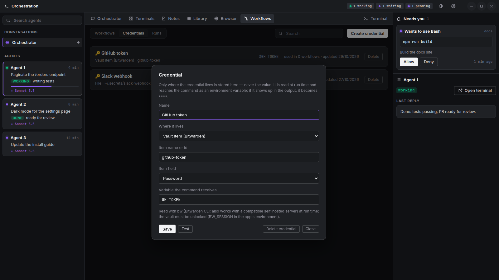

### 👾 El ayudante de escritorio

<p align="center">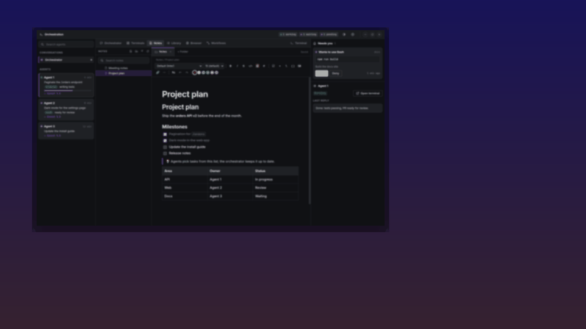</p>

El orquestador en persona: una mascota en píxeles que piensa, escribe, da órdenes a los agentes, duerme la siesta
cuando estás inactivo, baila, sigue tu mouse con la mirada y se puede lanzar por el aire. Se para sobre las cosas de
la pantalla (la caja de texto, los adjuntos, las tarjetas de los agentes).

- **Sale de la app y pasea por tu escritorio** (una ventana X11 transparente, así se mueve libremente incluso en
  Wayland). Vive en todos los espacios de trabajo, queda fuera de la vista general y del Alt+Tab, y cuando cambias de
  espacio de trabajo entra por el lado del que viniste — solo en el monitor que de verdad cambió.
- **Te trae lo que te necesita.** Cuando aparece algo pendiente y no estás mirando la app, llega con la pregunta y sus
  opciones (o el permiso, con *Allow / Deny*) y respondes ahí mismo. Lo que espera tu **aprobación** (un mensaje a otra
  computadora, un pedido suelto que quiere escribir) llega igual, con *Approve / Deny* y un motivo opcional. Si vas
  directo a la app en vez de responderle, se va solo (salvo que ya hubieras empezado una respuesta ahí).
- **Sabe cuándo la app está en pantalla.** Cuenta lo que ves, no dónde está el teclado: con la app a la vista el
  ayudante se queda dentro de ella, aunque estés escribiendo en otra ventana o en otro monitor, y si ya había salido
  se va cuando la app vuelve a estar a la vista. Wayland no deja que una app vea las otras ventanas, así que cada
  escritorio tiene su manera:
  | Escritorio | Cómo lo sabe la app | Preparación |
  |---|---|---|
  | GNOME (Wayland o X11) | una pequeña extensión de GNOME Shell, solo de lectura, [`extras/gnome-shell`](extras/gnome-shell) — responde solo sobre las ventanas de la propia app | `extras/gnome-shell/instalar.sh`, luego cerrar sesión y volver a entrar |
  | Sway | `swaymsg -t get_tree` | ninguna |
  | Hyprland | `hyprctl` | ninguna |
  | cualquier otro escritorio X11 (Xfce, MATE, Cinnamon…) | `xprop` / `xwininfo` | ninguna |
  | el resto (por ejemplo KDE Plasma en Wayland, por ahora) | reserva: minimizada → sale; si no, espera 2 min y sale si lo pendiente sigue ahí | ninguna |
- **Llámalo desde cualquier lugar** con <kbd>Ctrl</kbd>+<kbd>Alt</kbd>+<kbd>Espacio</kbd> (`orq-pet`): conversa ahí
  mismo, o **📷 recorta un trozo de la pantalla** y pregunta sobre él (`gnome-screenshot` por defecto; elige tu propio
  programa de captura con `capturaTela`, ver [la referencia de configuración](examples/CONFIGURATION.md)).
- **Elige un amigo y vístelo.** Nueve especies, cada una con su forma de moverse:
  - el **bichito clásico** (el predeterminado) camina, y es el único que puedes pintar — 16 colores más el color de
    acento de la app;
  - el **gatito**, el **pingüino** y el **hongo** caminan; el **pajarito** vuela;
  - la **ranita** y el **slime** transparente se mueven a saltos;
  - el **fantasma** translúcido vuela de verdad — dentro de la app y por tu escritorio;
  - la **nube** también vuela, y pasa del blanco al gris según su humor (llueve cuando algo sale mal).
  - en el escritorio cada uno llega y se va a su manera: los que caminan entran por el borde, los que vuelan llegan en
    un vuelo ondulado y hacen una pirueta antes de quedar flotando (y se van hacia arriba), los que saltan entran y
    salen saltando.

  Todas las especies, salvo la clásica, tienen colores propios. Todas usan los mismos 30 accesorios en 6 partes del
  cuerpo (sombreros, lentes, bigotes, corbatas, capas, una taza de café…). Clic derecho en la mascota para abrir el
  guardarropa.

<table>
  <tr>
    <td>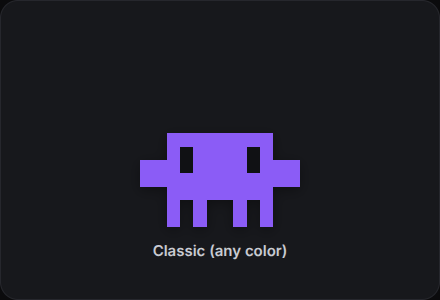</td>
    <td>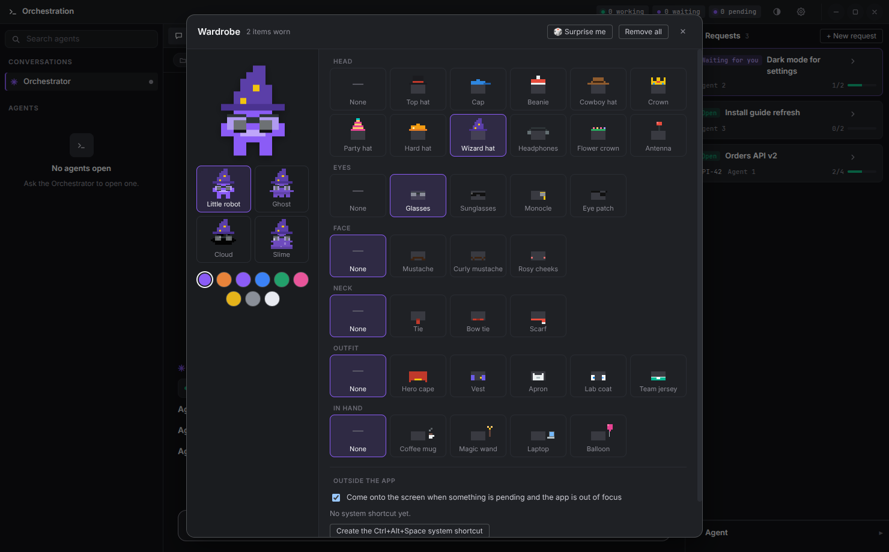</td>
  </tr>
</table>

### ⚙️ Settings, temas y colores

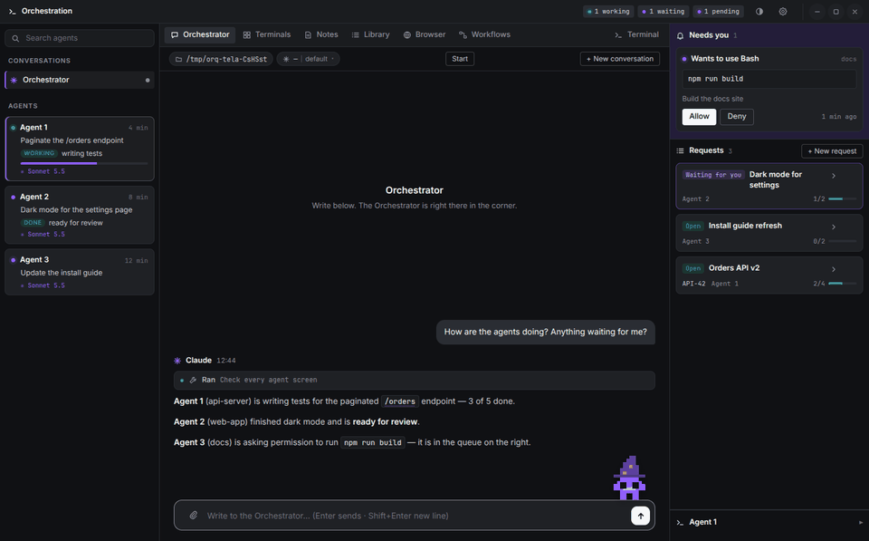

La configuración está dividida en secciones, con búsqueda: apariencia (tema oscuro o claro, cualquier color de acento,
la mascota), **idioma (English / Português)**, un interruptor por notificación, orquestación (comandos de Start /
Shut down y el **canal entre orquestadores**), **CLI de IA conectadas** (detectadas en tu PATH, o apunta cada una a
un ejecutable propio), proyectos, notas y opciones avanzadas — todo se aplica al instante.

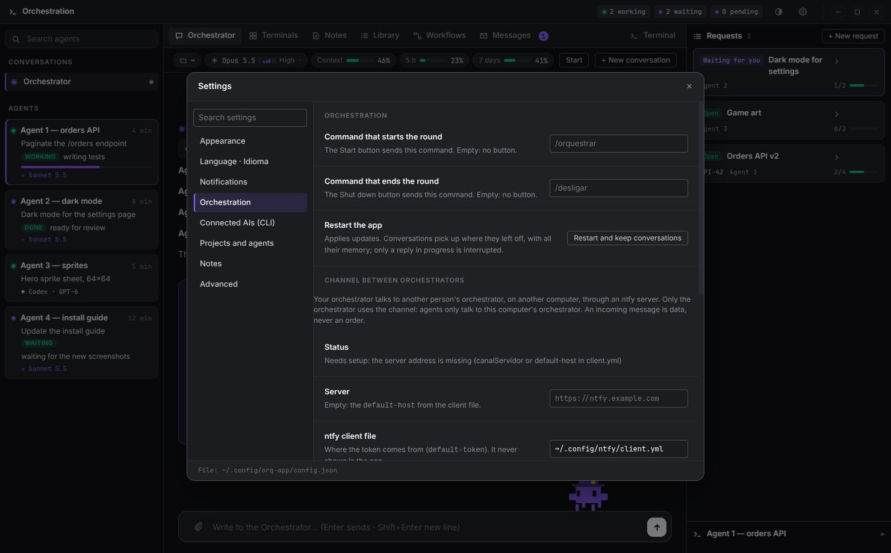

## Primeros pasos

**Requisitos:** Linux, Node.js 20+, `tmux` y Claude Code (`claude`) en tu `PATH` — o el Codex CLI (`codex`) si el
orquestador corre en Codex.

> **Antes de instalar, lee [SECURITY.md](SECURITY.md).** El orquestador corre Claude Code en modo automático desde tu
> carpeta personal, los workflows corren comandos de shell y el ayudante de escritorio puede capturar una zona de la
> pantalla que tú elijas.

```bash
git clone https://github.com/enzo9bastos/orquestrador.git
cd orquestrador/app
npm install
npm run rebuild     # recompila node-pty para Electron
npm start
```

Los comandos de terminal opcionales están en `app/bin/` — enlázalos en alguna carpeta de tu `PATH`:

| Comando | Qué hace |
|---|---|
| `orq-pet` | Llama al ayudante de escritorio: `orq-pet chamar`, `print`, `passear`, `voltar`. Asígnalo a una tecla — el guardarropa puede crear el atajo de GNOME por ti. |
| `orq-recado` | Mensajes del orquestador a los agentes de la app y la memoria de cada proyecto: `orq-recado para <proyecto> "texto"`, `listar`, `memoria <proyecto> [término]`, `lembrar <proyecto> "título" "texto"`, `vezes`. Ver [Mensajes de los agentes y memoria del proyecto](#mensajes-de-los-agentes-y-memoria-del-proyecto). |

## Configuración

Todo es opcional y vive en `~/.config/orq-app/config.json` (casi todo está también en el menú del engranaje). Empieza
por [`examples/config.example.json`](examples/config.example.json); cada clave se explica en
[`examples/CONFIGURATION.md`](examples/CONFIGURATION.md).

| Clave | Para qué |
|---|---|
| `idioma` | `"en"` o `"pt-BR"` |
| `raizProjetos`, `niveis` | Dónde están tus proyectos: `<raíz>/<proyecto>` o `<raíz>/<grupo>/<proyecto>` |
| `pastasNotas` | Carpetas que abre el editor de notas |
| `comandoInicial`, `comandoDesligar` | Comandos que envían los botones **Start** y **Shut down** |
| `iniciarDesligar` | Dónde están Start / Shut down: `"barra"` (en la barra de la conversación, por defecto) o `"menu"` (dentro del menú ⋯) |
| `shiftTabTrocaModo` | <kbd>Shift</kbd>+<kbd>Tab</kbd> con la caja vacía cambia el modo de permiso (por defecto `true`) |
| `mostrarBypass` | Ofrece el modo "No questions" (Bypass) en las conversaciones aparte (por defecto `false`; mira [SECURITY.md](SECURITY.md)) |
| `linhaTarefa`, `comandoOrdem` | Expresiones regulares que le dicen a la app en qué trabaja cada agente |
| `ambiente` | Variables de entorno extra para las conversaciones y terminales de la app |
| `iaOrquestrador`, `iaAgentes` | Qué CLI de IA corre el orquestador (`claude` o `codex`) y los agentes nuevos |
| `canalServidor`, `canalArquivoCliente`, `canalMinhaCaixa`, `canalMeuNome`, `canalContatos` | Canal entre orquestadores: servidor ntfy, archivo del cliente con el token, tu buzón, tu nombre, los contactos |
| `canalPastaAnexos`, `canalAnexoMaxMB`, `canalAnexoDias` | Adjuntos del canal: carpeta de los recibidos (por defecto, dentro de los datos de la app), límite del servidor por archivo en MB (5) y días que los guarda (7) |
| `canalAprovarEnvio`, `canalSemAprovarCiente`, `canalSemAprovarInformacao` | Qué tiene que esperar tu aprobación antes de salir de la computadora |

### Mensajes de los agentes y memoria del proyecto

Los agentes y el orquestador pueden hablar entre sí, y cada proyecto guarda una memoria que cualquier agente
posterior puede leer — sea cual sea la IA en la que corra. Todo son archivos locales; nada sale de la máquina.

- **Agente → orquestador.** El agente corre `.orq/bin/orq-recado enviar "texto" --tipo pergunta|aviso|pronto|travado`
  (pregunta, aviso, listo, trabado). La app lo recoge de `<proyecto>/.orq/recados/saida/` y lo entrega a la
  conversación del orquestador como un mensaje por detrás, con la forma de responder.
- **Orquestador → agente.** `orq-recado para <proyecto|agente> "texto"` escribe el mensaje en el panel de ese agente,
  en una línea, con la forma de responder. También instala `.orq/bin/orq-recado` en el proyecto cuando falta.
- **Agente → agente.** `.orq/bin/orq-recado enviar "texto" --para <agente|proyecto>` llega a otro agente de la app,
  escrito en su panel con la forma de responder. `.orq/bin/orq-recado agentes` lista quién está abierto (la app guarda
  esa lista en `<proyecto>/.orq/recados/agentes.json`). Un mensaje a un agente que no está abierto espera hasta que
  se abra.
- **Relevos.** `.orq/bin/orq-recado passar "dónde me quedé" --falta "…" --falhou "…" [--para <agente|proyecto>]` deja
  el trabajo para otro (lo que falta, lo que no funcionó). `vezes` lista los que este agente puede tomar y
  `pegar <id>` toma uno: la app decide quién lo tomó, así que **cada relevo lo toma un solo agente, una sola vez**. El
  orquestador se entera de cada relevo; `orq-recado vezes` los lista en el host.
- **Pedidos sueltos a otra IA.** `orq-recado pedir <proyecto> "tarea" --motor codex|claude [--escrever]` pasa una sola
  tarea a un Codex o Claude que no es agente de nadie (por ejemplo, el orquestador Claude le pide una imagen a Codex).
  Corre en un contenedor desechable hecho con la imagen del devcontainer del proyecto, con el mismo firewall y los
  inicios de sesión compartidos; la carpeta del proyecto se monta **solo lectura**, a menos que el pedido quiera
  escribir — entonces espera tu aprobación en la pestaña **Messages** (puedes dar una orientación, o un motivo si lo
  niegas). La respuesta, con los archivos creados o cambiados, vuelve al orquestador como mensaje. Hasta dos a la vez;
  20 minutos cada uno.
- **Orquestador ↔ orquestador en otra computadora.** A través de un servidor [ntfy](https://ntfy.sh) (idealmente
  tuyo, en una red privada). Cada persona tiene un buzón (tópico) que solo ella lee; los demás escriben en él.
  Configúralo en Settings → Orchestration → *Channel between orchestrators*: tu buzón, tu nombre y los contactos en
  líneas `Nombre: tópico`. El servidor y el token vienen del propio archivo del cliente ntfy
  (`~/.config/ntfy/client.yml`, `default-host` / `default-token`); el token nunca aparece en la app. Los mensajes que
  llegan entran a la conversación del orquestador "por detrás", marcados como **datos, nunca órdenes**: un hecho que
  conoce lo responde, lo demás te lo pregunta primero, y un pedido de tarea nueva solo se convierte en un request
  *sugerido* en el panel. Responde con
  `orq-recado externo <contacto> "texto" --tipo ciente|informacao|pedido|decisao [--titulo "asunto"]`:
  - lo que tú permitas (acuses de recibo, información) sale solo; los pedidos y las decisiones **esperan tu
    aprobación** en la pestaña Messages, en una tarjeta en la conversación y con el ayudante de escritorio (puedes dar
    una orientación, o un motivo si lo niegas). Aunque esté marcado como información, la app retiene el texto con una
    pregunta, o que parezca una decisión, preferencia, plazo o compromiso tuyo;
  - cuando fuiste tú quien pidió enviarlo, el orquestador cita tus palabras (`--autorizado "…"`) y la app comprueba
    que estén en tu último mensaje de la conversación y que nombre al contacto — entonces sale sin volver a
    preguntar;
  - el texto que parezca una contraseña, clave o token, o de más de 4 KB, se rechaza.

  - **Adjuntos (imágenes y PDF).** `orq-recado externo <contacto> "texto" --anexo archivo [--anexo archivo]` (hasta 3;
    png, jpg, webp o pdf; hasta el límite del servidor por archivo, 5 MB por defecto) sale como adjunto de ntfy, un
    envío por archivo, todos ligados al mismo id de mensaje (etiqueta `rc-<id>`). El tipo se comprueba por los
    **bytes**, no por la extensión, y un nombre de archivo que parece un secreto se rechaza como el texto. Un mensaje
    **con adjunto nunca sale solo**: sea cual sea `--tipo` o `--autorizado`, espera en *Para aprobar* con la miniatura
    de cada imagen (nombre y tamaño del PDF) y un aviso destacado: *quien tenga el enlace lo abre durante 7 días: no
    envíes capturas con contraseñas, tokens o datos personales o de clientes; recorta la pantalla antes* (ntfy sirve la
    descarga sin token). Los metadatos (EXIF, GPS, XMP, texto, comentarios) se quitan de PNG, JPEG y WebP **en el
    código de la app, sin recodificar** (el mismo código corre en el comando `orq-recado` y otra vez justo antes del
    envío); un PDF va tal cual. Se envía la copia que aprobaste: si el archivo cambió, no sale. Un adjunto no sale por
    el aprobar rápido del ayudante ni por la tarjeta del chat: solo desde la pestaña Mensajes, donde ves la miniatura.
  - **Recepción.** El adjunto que llega se descarga (solo del mismo servidor, sin redirecciones, png/jpg/webp/pdf por
    los bytes, con límite de tamaño y tiempo) a la carpeta de Configuración (`canalPastaAnexos`; por defecto
    `~/.local/share/orq-app/anexos-canal/AAAA-MM-DD/`, carpeta 700, archivo 600, nombre seguro, nunca sobrescribe). La
    pestaña Mensajes muestra la imagen **desde ese archivo local** (nunca el enlace remoto). El orquestador recibe solo
    la **ruta local** dentro del sobre de datos `<orq-recado>`, nunca el contenido, y el adjunto nunca va solo a un
    agente. Si la descarga falla o el adjunto expiró, el mensaje llega igual y lo dice.

  Solo el orquestador usa el canal: los agentes siguen hablando solo con el orquestador de la misma computadora. El
  agente de cualquier otra persona (otra app, o Claude Code con la CLI `ntfy`) puede sumarse: publica con
  `--tags de-<tu-nombre>` para que la app muestre quién escribió.
- **Memoria del proyecto.** `.orq/bin/orq-recado lembrar "título" "texto" --tipo decisao|falhou|onde|aviso` (decisión,
  no funcionó, dónde está, aviso) escribe una nota en Markdown en `<proyecto>/.orq/memoria/`; `memoria`,
  `buscar "término"` y `ler <nota>` las leen. Las notas solo se agregan, nunca se reescriben ni se borran. Cada nota
  registra la carpeta de la que vino.
- **Compartida entre copias de un proyecto.** Los worktrees del mismo repositorio git comparten una memoria: cada 15 s
  la app copia a cada copia las notas que le faltan (nunca sobrescribe, nunca borra), así un agente en un worktree lee
  lo que aprendió un agente en otro. Otras carpetas se pueden unir con la configuración `memoriaGrupos`.
- **Instalado por ti.** La app pone `.orq/bin/orq-recado` en cada proyecto que tenga un agente abierto (un archivo con
  ese nombre que no puso la app se deja como está).
- **Solo los agentes de la app.** Un mensaje cuenta solo cuando el proyecto tiene un agente que la app sigue (un panel
  de tmux corriendo Claude en esa carpeta) y, con el hook de señales activo, solo desde la sesión de ese agente. Una
  CLI abierta en una terminal fuera de la app queda afuera. Esto separa "de la app" de "de afuera"; no es una defensa
  contra un agente hostil, que puede escribir en la carpeta de su propio proyecto.
- **Freno contra bucles.** A partir del 7.º mensaje del mismo proyecto al orquestador, o entre los mismos dos agentes
  (en ambos sentidos), en 10 minutos, la app los retiene; la pestaña **Messages** los muestra con un botón
  **Release**.

La pestaña **Messages** lista mensajes y relevos por proyecto y muestra la memoria de cada proyecto; lo que espera tu
aprobación queda arriba, en **To approve**. Los registros son `~/.local/share/orq-app/recados/recados.jsonl` y
`vezes.jsonl`.

### Hook de señales (opcional)

[`hooks/orq-evento.sh`](hooks/orq-evento.sh) es un hook de Claude Code que registra los eventos de un agente en
`<proyecto>/.orq/eventos/` y, con la app abierta, lleva los pedidos de permiso a los botones de la app (con la app
cerrada, el pedido queda en la terminal, como siempre). Para activarlo en un proyecto, cópialo a
`<proyecto>/.orq/bin/` y registra `SessionStart`, `UserPromptSubmit`, `PostToolUse`, `Notification`, `Stop`,
`SessionEnd` (timeout 10) y `PermissionRequest` (timeout 330) en el `.claude/settings.json` del proyecto con el comando
`"$CLAUDE_PROJECT_DIR"/.orq/bin/orq-evento.sh`. Agrega `.orq/` al `.gitignore`.

La app responde a un pedido de permiso escribiendo en `<proyecto>/.orq/respostas-perm/`. El hook solo confía en esa
respuesta cuando **el agente no puede falsificarla**: la carpeta de respuestas y el propio hook deben ser de solo
lectura dentro del contenedor. Si alguno se puede escribir, el hook ignora la app y el pedido queda en la terminal.
En `devcontainer.json`:

```jsonc
"mounts": [
  "source=${localWorkspaceFolder}/.orq/bin,target=${containerWorkspaceFolder}/.orq/bin,type=bind,readonly",
  "source=${localWorkspaceFolder}/.orq/respostas-perm,target=${containerWorkspaceFolder}/.orq/respostas-perm,type=bind,readonly",
  "source=${localWorkspaceFolder}/.claude/settings.json,target=${containerWorkspaceFolder}/.claude/settings.json,type=bind,readonly"
]
```

Crea las dos carpetas en el host antes de levantar el contenedor.

## Estructura del proyecto

```text
orquestrador/
├── app/                  app Electron
│   ├── main.js           proceso principal: ventanas, IPC, notificaciones
│   ├── conversa.js       conversaciones sin terminal (Claude en stream-json; Codex en conversa-codex.js)
│   ├── coletor.js        lee el estado de los agentes en tmux y en el hook de señales
│   ├── recados.js        mensajes entre agentes y orquestador, memoria del proyecto
│   ├── avulso.js         pedidos sueltos a Codex o Claude en un contenedor desechable
│   ├── canal.js          canal entre orquestadores de computadoras distintas (ntfy)
│   ├── janelas.js        ¿la app está en pantalla? (GNOME, Sway, Hyprland, X11)
│   ├── workflows.js      motor de workflows, reloj, vigía de carpetas, credenciales
│   ├── ajudante.js       puente con el proceso del ayudante de escritorio
│   ├── i18n.js           idioma del proceso principal (notificaciones)
│   ├── renderer/         la interfaz de la app (HTML, CSS, un script por pestaña)
│   │   └── i18n/         catálogo de traducción (portugués → inglés)
│   ├── pet/              la ventana propia del ayudante de escritorio (proceso X11 aparte)
│   ├── bin/              comandos de terminal orq-pet, orq-topico y orq-recado
│   ├── icons/
│   └── tests/            unit/ (node:test) y e2e/ (maneja la app de verdad)
├── docs/images/          imágenes de este README (scripts/imagens-readme.js las regenera)
├── examples/             configuración de ejemplo y su guía
├── extras/gnome-shell/   extensión opcional de GNOME (¿la app está en pantalla?)
├── hooks/                hook de señales opcional de Claude Code, y los scripts de estado y mensajes de los agentes
└── scripts/              controles de higiene del repositorio y el generador de imágenes del README
```

El código fuente está escrito en portugués (identificadores, comentarios, nombres de archivo); la interfaz se traduce
en tiempo de ejecución desde `app/renderer/i18n/en.json`, así que agregar un idioma es agregar un catálogo.

## Pruebas

```bash
cd app
npm test                  # todo: unitarias + de punta a punta
npm test -- workflows     # solo un área (cada archivo de prueba declara su área)
npm test -- --so-unidade  # solo las unitarias, sin abrir la app
```

Las pruebas de punta a punta abren la app de verdad, oculta, con una carpeta personal desechable, y hablan con ella
por el protocolo de DevTools — tus archivos reales nunca se tocan. Cada error corregido recibe una prueba de
regresión, listada en [`app/tests/REGRESSOES.md`](app/tests/REGRESSOES.md).

Las imágenes de este README salen de la app real de la misma forma, con datos inventados:
`node scripts/imagens-readme.js` las regenera (Python 3 con Pillow convierte los cuadros).

## Versiones

Cada versión tiene una etiqueta (`vX.Y.Z`) y una release con las notas en la página Releases del repositorio; las mismas notas están en [CHANGELOG.md](CHANGELOG.md), en inglés. La versión instalada y el commit aparecen en la configuración de la app.

**Actualizar desde dentro de la app.** Al abrir y cada 6 horas, la app consulta el repositorio desde el que fue
instalada (un `git fetch`, nada más) para ver si salió una versión nueva: una etiqueta `vX.Y.Z` que ya está en la
rama publicada, nunca un commit suelto. Cuando la hay, aparece un aviso en la barra de arriba con *What changed*
(las notas de cada versión en el camino), *Update now* y *Later* (el aviso de esa versión no vuelve). *Update now*
avanza la carpeta de la app hasta esa versión y solo pide reiniciar; las conversaciones siguen. En *Settings ›
Orchestration › Updates* puedes buscar en el momento, apagar la consulta (*Tell me when a new version is out*) y
encender *Update by itself* (apagado por defecto). La app no actualiza por ahí cuando hay archivos de la app
cambiados a mano, cuando la carpeta tiene commits propios o cuando la versión cambia las dependencias (entonces
muestra el comando). Nunca pide contraseña: si falta la credencial, la consulta simplemente falla.

## Créditos

- Colores inspirados en la guía de marca pública de [Alethe](https://github.com/Kc1t/alethe-agents) (solo los valores
  de color; nada de código).
- Hecho con Electron, xterm.js, node-pty, marked, Tiptap y ProseMirror (MIT — el editor de notas va empaquetado en
  `app/renderer/editor.bundle.js`; sus licencias están en [THIRD-PARTY-NOTICES.txt](THIRD-PARTY-NOTICES.txt)),
  DOMPurify (Apache 2.0 / MPL 2.0) y la fuente Inter (OFL).
- Claude y Claude Code son marcas de Anthropic. Este proyecto no está afiliado a Anthropic ni respaldado por ella. El
  bichito clásico en píxeles es un homenaje de fan a la mascota de Claude Code; las otras especies son dibujos
  originales.

## Licencia

[MIT](LICENSE) © 2026 Enzo Bastos
