<div align="center">

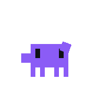

# Orquestrador

**A desktop cockpit for AI agents and orchestrators — built on the AI coding CLIs you already use.**

Chat with an orchestrator, watch every agent at a glance, answer what needs you from one queue,<br>
automate your machine with visual workflows — and meet the little pixel helper that lives on your desktop.


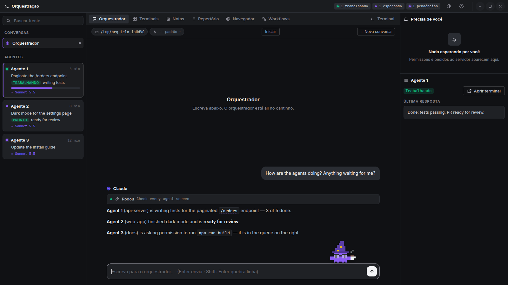

[Why](#why) · [Tour](#a-tour-of-the-app) · [Getting started](#getting-started) · [Configuration](#configuration) · [Project structure](#project-structure) · [Tests](#tests)

</div>

## Why

Running several AI coding agents in parallel quickly turns into a wall of terminals. Orquestrador keeps
the agents exactly where they already work — `tmux` sessions, ideally inside devcontainers — and puts a
calm shell on top: one place to talk to the orchestrator, see who is doing what, and act on whatever is
waiting for you. Closing the app never stops an agent.

**It drives the AIs through their own command-line tools** — no API keys to paste, no extra accounts:
whatever CLI you are already logged into does the work. Settings → *Connected AIs (CLI)* shows which
ones are installed. The orchestrator runs on [Claude Code](https://claude.com/claude-code) or on the **Codex CLI**
(Settings → *Orchestrator AI*; each one keeps its own conversation when you switch). Agents can run on either
(the app recognizes each one in a terminal and shows which, with its model), and an orchestrator can hand one-off
tasks to either (`orq-recado pedir`). The Codex orchestrator talks to `codex app-server`: its multiple-choice
questions and approvals become the same cards as Claude's. It runs outside Codex's sandbox (the `orq` commands need
tmux and docker), with the `untrusted` approval policy and Codex's own `auto_review` reviewer deciding every command
that is not read-only; a denial shows up in the chat with the reviewer's reason. The start command (e.g.
`/orquestrar-app`) is sent as the Codex skill of the same name from `~/.codex/skills`. Gemini CLI, OpenCode and
others are on the roadmap — see [`docs/MULTI-LLM-PLAN.md`](docs/MULTI-LLM-PLAN.md). Ideas for later live in [`docs/IDEAS.md`](docs/IDEAS.md).
The Library and the workflows already work with any of them.

The app speaks **English and Portuguese** — switch in ⚙ Settings → *App language*.

## A tour of the app

The window has three columns: **conversations and agents** on the left, the **current tab** in the
middle, and **Needs you** (the queue) plus the selected agent's details on the right.

### 💬 Orchestrator

The conversation with the orchestrator — Claude running headless (`stream-json`, the Agent SDK
protocol), so there is no terminal to babysit.

- Markdown answers, collapsible tool calls (*Ran …*, *Read …*), question cards with clickable options,
  **Allow / Deny** on permission requests, `/command` autocomplete.
- Model and effort switcher, context and usage meters (5-hour and 7-day windows) in the top bar; each reply shows
  its time next to Claude's name (with the date when it is from another day).
- **Start** sends your round-opening command (e.g. a skill of yours); **Shut down** ends the round safely.
- Paste, drag or attach (📎) screenshots and files — images go as images, other files by their path; right-click a
  misspelled word for suggestions (Portuguese and English); `//skill` uses anything from the Library; `@note:` and
  `@workflow:` attach a note or a workflow; code blocks have *Copy* and *▶ Terminal*.
- **Sent something wrong?** Hover your message and click ✎ to **rewind**: that message and everything after it
  leave Claude's context (the old conversation is kept) and the text comes back to the box to fix. With the box
  empty, ↑ / ↓ bring back what you sent.
- **New conversation** opens side conversations next to the orchestrator.

### 🧭 Agents and *Needs you*

Every agent appears in the left column with its state (working, waiting for you, asking permission),
its current task, a progress bar and its model. Click one to see its last reply and timeline on the
right, or open its terminal. **Needs you** gathers every permission request and pending question from
all agents into one queue with buttons.

### 📌 Requests

The right column keeps one compact card per request being worked on: title, state, ticket code, the agents on
it and a progress bar. **Each approved request is a Markdown note** in `Notes › <your first notes folder> ›
Demandas/` — click the card and it opens in the Notes tab, where the summary, the checklist and your own
*Anotações* (free notes the app never touches) live. Tick a step or change the `Estado:` line in the note and
the card follows; finished requests stay in the folder as "Title - Concluída.md".
The arrow on a card lists the steps still to do without leaving the panel. Hover a card for the trash icon: after a
second click the request leaves the panel and its note goes to the system trash.

As work comes in, the **orchestrator suggests a request** (title, summary and planned steps) with
`orq-topico sugerir`; you **approve or reject** it on the card — fixing the title first if you want. Only approved
requests become notes. The orchestrator then creates the steps, ticks them as the work gets done and finishes the
request when everything is done. Every save keeps the previous version. *Needs you*
sits above as a strip that only shows up when something is waiting.

### 🖥️ Terminals

Up to four terminals in a grid, including ones attached to an agent's own `tmux` session — plus a spare
shell in the **Terminal** tab on the right.

### 📝 Notes

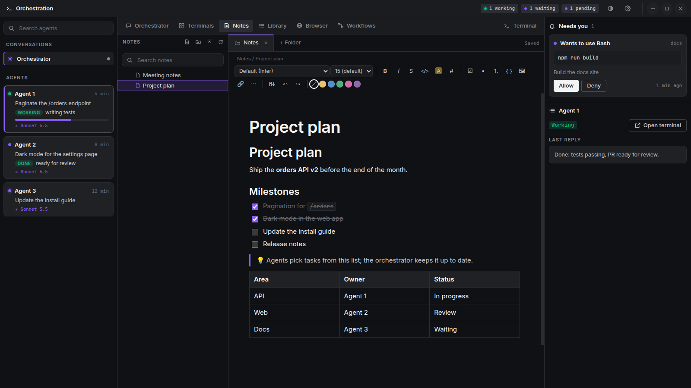

A Notion-style Markdown editor over the folders you choose: blocks, `/` menu, checklists, tables,
callouts, images. It autosaves and keeps every previous version; deleting a note sends it to the system trash.
Right-click a folder to **hide it from Notes** (nothing is deleted; bring it back from the empty-space menu ›
*Hidden folders*) or to **move it to the trash** after a confirmation that says how many notes and files go with it.

### 📚 Library

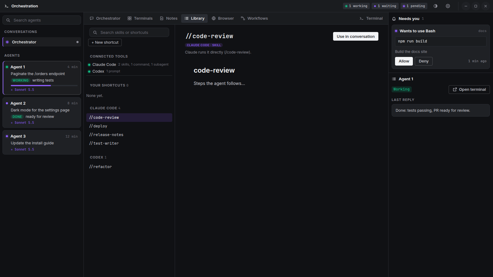

Finds what you created in each AI tool — skills, commands, sub-agents, prompts and workflows from Claude
Code, Codex, Gemini CLI, OpenCode, Windsurf and Cursor — and lets you add your own shortcuts (optionally
bound to <kbd>Ctrl</kbd>+<kbd>Alt</kbd>+<kbd>1…9</kbd>). Type `//name` in any conversation to use one;
skills from other tools are sent with their instructions so any model can follow them.

### ⚡ Workflows

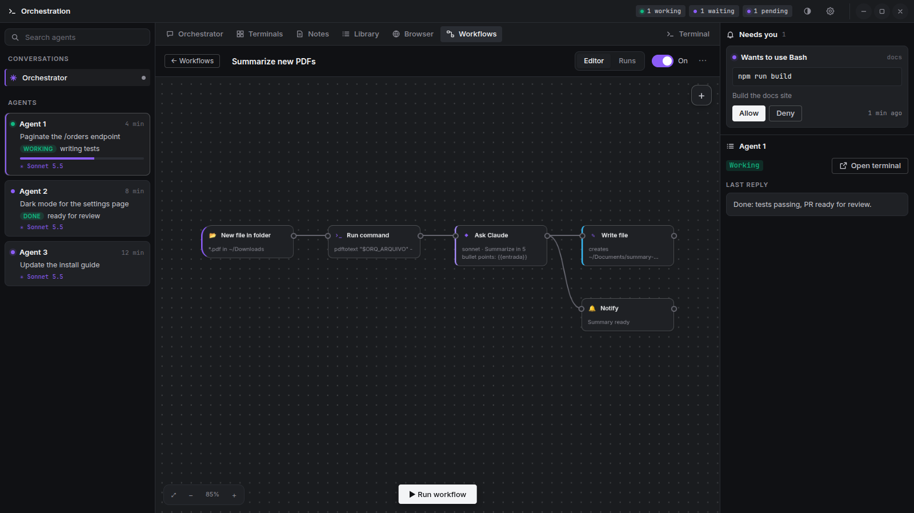

n8n-style automations for your machine. The home screen lists **Workflows**, **Credentials** and
**Runs**; opening a workflow shows a full-screen canvas.

- **Triggers:** a clock (every N minutes — optionally only inside working hours such as 08:00–18:00 —
  or daily at a time; weekdays only if you want; a daily run missed while the computer was off can run
  when the app opens), a manual button, or **a new file in a folder** (e.g. `*.pdf` in `~/Downloads`).
- **Steps:** send a message to the orchestrator (in the background — never as if you typed it), **ask an
  AI** — through your subscription (Claude Code or Codex CLI, nothing extra to pay, good for light jobs)
  or through an API — Anthropic, or **any OpenAI-compatible API** (OpenAI, OpenRouter, Groq, DeepSeek, Mistral, Gemini, or a local Ollama / LM Studio, with no key) — call any API with an **HTTP request** (credentials go in
  as `$VARIABLE` and are masked in the output), run a shell command, read / move / copy / write files,
  branch on a condition, show a desktop notification. Workflows run only while the app is open: they
  are for your working hours, not a 24/7 server. The output of one step is the input of the next
  (`{{entrada}}`); `{{arquivo}}` and `{{nome_arquivo}}` refer to the file that fired the workflow.
- **Canvas like n8n / Maestri:** middle-drag to pan, <kbd>Ctrl</kbd>+wheel to zoom, rubber-band
  selection, right-click menus, <kbd>Ctrl</kbd>+<kbd>A</kbd> / <kbd>Ctrl</kbd>+<kbd>D</kbd> /
  <kbd>Delete</kbd>, double-click a step to edit it.
- **Safe with your files:** file steps never overwrite — an existing name gets `-2`, `-3`…
- Every run is kept with each step's output.

<table>
  <tr>
    <td>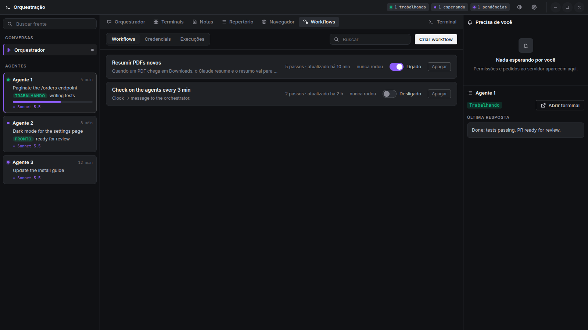</td>
    <td>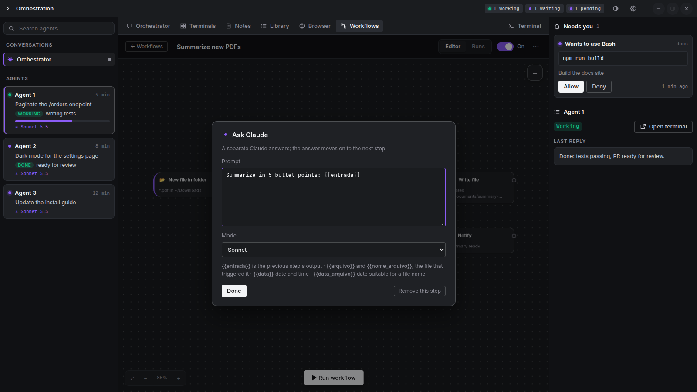</td>
  </tr>
  <tr>
    <td align="center"><sub>Workflows, credentials and runs</sub></td>
    <td align="center"><sub>Double-click a step to edit it</sub></td>
  </tr>
</table>

**Credentials by reference only.** The app stores *where* a secret lives — a Bitwarden item, a file or
an environment variable — never its value. It is read at run time, handed to the command as an
environment variable and masked as `••••` in any saved output. *Test* only tells you how many
characters it read.
The vault session (`BW_SESSION`) and the variables registered as credentials are stripped from every
conversation, terminal and workflow step: only the step that picked a credential receives it.

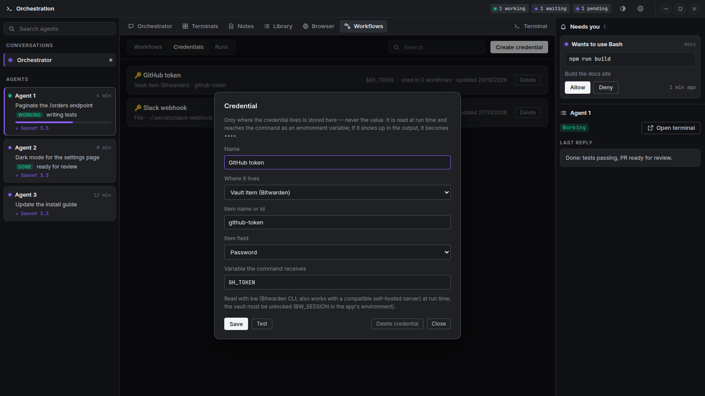

### 👾 The desktop helper

<p align="center">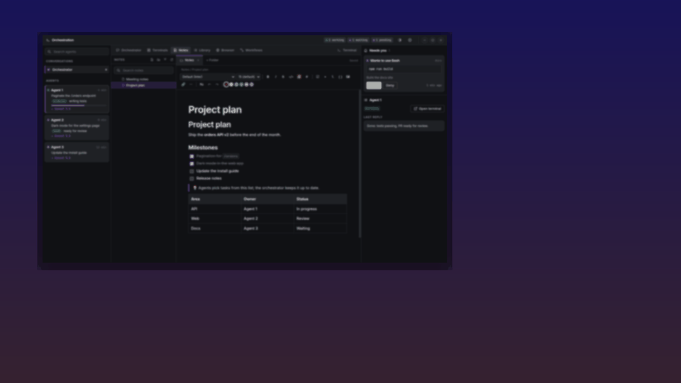</p>

The orchestrator in person: a pixel pet that thinks, types, gives orders to the agents, naps when you are
idle, dances, follows your mouse with its eyes and can be thrown around. It stands on top of the things on
screen (the input box, attachments, agent cards).

- **Leaves the app and walks your desktop** (a transparent X11 window, so it can move freely even on
  Wayland). It lives on every workspace, stays out of the overview and Alt+Tab, and when you switch
  workspaces it walks in from the side you came from — only on the monitor that actually switched.
- **Brings you what needs you.** When something new is pending and the app is not focused, it walks in
  with the question and its options (or the permission, with *Allow / Deny*) and you answer right there.
- **Call it from anywhere** with <kbd>Ctrl</kbd>+<kbd>Alt</kbd>+<kbd>Space</kbd> (`orq-pet`): chat right
  there, or **📷 crop a piece of your screen** and ask about it (`gnome-screenshot` by default; set your own
  capture program with `capturaTela`, see [the configuration reference](examples/CONFIGURATION.md)).
- **Pick a friend and dress it up.** Nine species, each with its own way of moving:
  - the **classic critter** (the default) walks, and is the only one you can paint — 16 colors plus your app accent;
  - the **kitten**, the **penguin** and the **mushroom** walk; the **little bird** flies;
  - the **little frog** and the see-through **slime** get around by hopping;
  - the translucent **ghost** really flies around — inside the app and across your desktop;
  - the **cloud** flies too, and changes from white to gray with its mood (it rains when something goes wrong).
  - out on the desktop each one arrives and leaves its own way: walkers come in from the edge, flyers swoop in on a
    wavy flight and twirl before hovering (and fly off upward), hoppers bounce in and out.

  Every species but the classic has its own colors. They all wear the same 30 items across 6 slots (hats, glasses,
  moustaches, ties, capes, a coffee mug…). Right-click the pet to open the wardrobe.

<table>
  <tr>
    <td>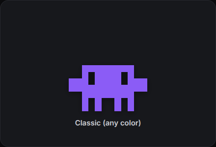</td>
    <td>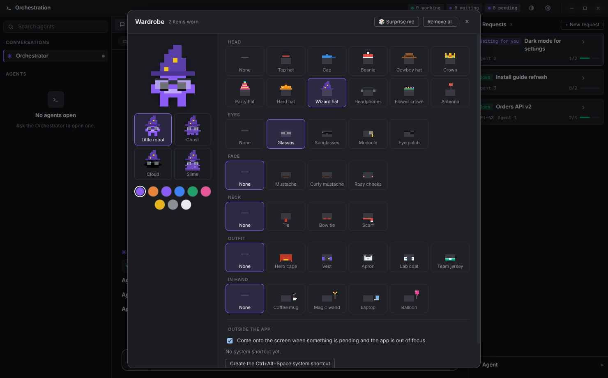</td>
  </tr>
</table>

### ⚙️ Settings, themes and colors

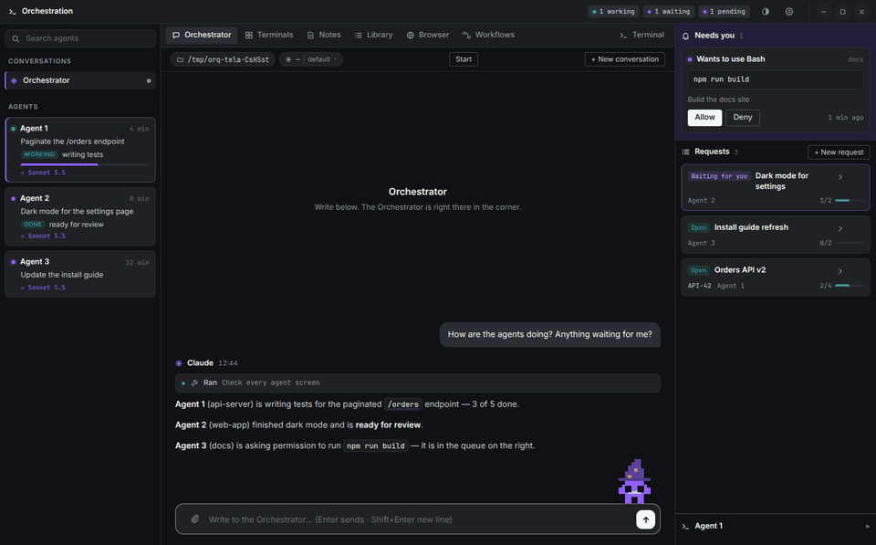

Settings are split into sections with search: appearance (dark or light theme, any accent color, the pet),
**language (English / Português)**, one switch per notification, orchestration (Start / Shut down
commands), **connected AI CLIs** (detected on your PATH, or point each one to a custom executable), projects, notes and advanced options — applied immediately.

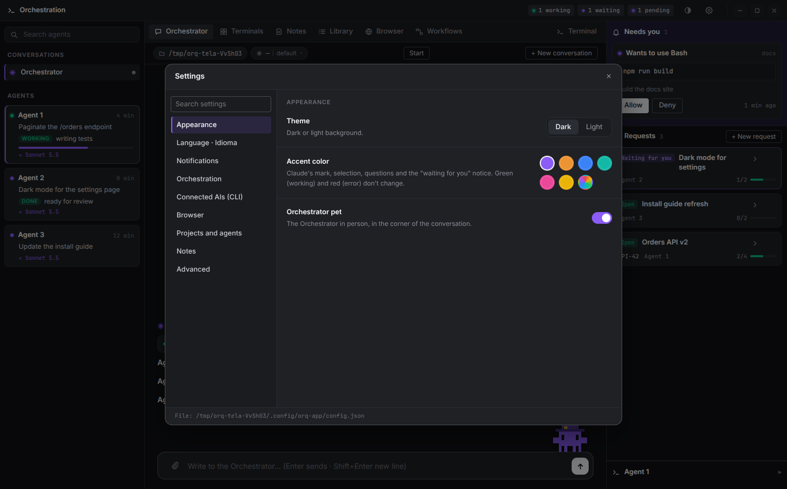

## Getting started

**Requirements:** Linux, Node.js 20+, `tmux`, and Claude Code (`claude`) on your `PATH`.

> **Before installing, read [SECURITY.md](SECURITY.md).** The orchestrator runs Claude Code in auto mode
> from your home folder, workflows run shell commands, and the desktop helper can capture a screen area you select.

```bash
git clone https://github.com/enzo9bastos/orquestrador.git
cd orquestrador/app
npm install
npm run rebuild     # rebuilds node-pty for Electron
npm start
```

Optional command-line helpers live in `app/bin/` — link them somewhere on your `PATH`:

| Command | What it does |
|---|---|
| `orq-pet` | Calls the desktop helper: `orq-pet chamar`, `print`, `passear`, `voltar`. Bind it to a key — the wardrobe can create the GNOME shortcut for you. |
| `orq-recado` | Messages from the orchestrator to the app's agents and each project's memory: `orq-recado para <project> "text"`, `listar`, `memoria <project> [term]`, `lembrar <project> "title" "text"`, `vezes`. See [Agent messages and project memory](#agent-messages-and-project-memory). |

## Configuration

Everything is optional and lives in `~/.config/orq-app/config.json` (most of it is also in the gear
menu). Start from [`examples/config.example.json`](examples/config.example.json); every key is explained
in [`examples/CONFIGURATION.md`](examples/CONFIGURATION.md).

| Key | Purpose |
|---|---|
| `idioma` | `"en"` or `"pt-BR"` |
| `raizProjetos`, `niveis` | Where your projects are: `<root>/<project>` or `<root>/<group>/<project>` |
| `pastasNotas` | Folders the notes editor opens |
| `comandoInicial`, `comandoDesligar` | Commands sent by the **Start** and **Shut down** buttons |
| `linhaTarefa`, `comandoOrdem` | Regular expressions that tell the app what each agent is working on |
| `ambiente` | Extra environment variables for the app's conversations and terminals |

### Agent messages and project memory

Agents and the orchestrator can talk to each other, and every project keeps a memory that any later agent can
read — whatever AI it runs on. Everything is local files; nothing leaves the machine.

- **Agent → orchestrator.** The agent runs `.orq/bin/orq-recado enviar "text" --tipo pergunta|aviso|pronto|travado`
  (question, notice, done, stuck). The app picks it up from `<project>/.orq/recados/saida/` and hands it to the
  orchestrator's chat as a behind-the-scenes message, with how to answer.
- **Orchestrator → agent.** `orq-recado para <project|agent> "text"` types the message into that agent's pane, in one
  line, with how to answer. It also installs `.orq/bin/orq-recado` in the project when it is missing.
- **Agent → agent.** `.orq/bin/orq-recado enviar "text" --para <agent|project>` reaches another agent of the app,
  typed into its pane with how to answer. `.orq/bin/orq-recado agentes` lists who is open (the app keeps that list in
  `<project>/.orq/recados/agentes.json`). A message to an agent that is not open waits until it opens.
- **Handoffs.** `.orq/bin/orq-recado passar "where I stopped" --falta "…" --falhou "…" [--para <agent|project>]` leaves the
  work for someone else (still to do, what didn't work). `vezes` lists the ones this agent can take and `pegar <id>`
  takes one: the app decides who got it, so **only one agent takes each handoff, once**. The orchestrator is told
  about every handoff; `orq-recado vezes` lists them on the host.
- **One-off requests to another AI.** `orq-recado pedir <project> "task" --motor codex|claude [--escrever]` hands a
  single task to a Codex or Claude that is nobody's agent (e.g. the Claude orchestrator asks Codex for an image). It
  runs in a throwaway container made from the project's devcontainer image, with the same firewall and the shared
  logins; the project folder is mounted **read-only** unless the request asks to write, and then it waits for your
  approval in the **Messages** tab (you may add guidance, or a reason when you deny). The answer, with the files it
  created or changed, comes back to the orchestrator as a message. Up to two run at once; 20 minutes each.
- **Orchestrator ↔ orchestrator on another computer.** Through an [ntfy](https://ntfy.sh) server (ideally your own,
  on a private network). Each person has an inbox topic only they read; the others write to it. Set it up in
  Settings → Orchestration → *Channel between orchestrators*: your inbox, your name, and contacts as
  `Name: topic` lines. The server and the token come from ntfy's own client file (`~/.config/ntfy/client.yml`,
  `default-host` / `default-token`); the token never shows in the app. Incoming messages reach the orchestrator
  "behind the scenes", marked as **data, never orders**. It answers with
  `orq-recado externo <contact> "text" [--titulo "subject"]`, and the message **waits for your approval** in the
  Messages tab before it leaves the computer (you may add guidance, or a reason when you deny). Text that looks like a
  password, key or token, or over 4 KB, is refused. Only the orchestrator uses the channel: agents keep talking only to
  the orchestrator on the same computer. Anyone else's agent (another app, or Claude Code with the `ntfy` CLI) can join:
  publish with `--tags de-<your-name>` so the app shows who wrote.
- **Project memory.** `.orq/bin/orq-recado lembrar "title" "text" --tipo decisao|falhou|onde|aviso` (decision,
  didn't work, where things are, notice) writes one Markdown note in `<project>/.orq/memoria/`; `memoria`, `buscar
  "term"` and `ler <note>` read them. Notes are only ever added, never rewritten or deleted. Each note records the
  folder it came from.
- **Shared between copies of a project.** Worktrees of the same git repository share one memory: every 15 s the app
  copies to each copy the notes it is missing (never overwriting, never deleting), so an agent in a worktree reads
  what an agent in another one learned. Other folders can be joined with the `memoriaGrupos` setting.
- **Installed for you.** The app puts `.orq/bin/orq-recado` in every project that has an agent open (a file with that
  name that the app did not put there is left alone).
- **Only the app's agents.** A message counts only when the project has an agent the app follows (a tmux pane
  running Claude in that folder) and, when the signal hook is on, only from that agent's session. A CLI opened in
  a terminal outside the app is turned away. This separates "in the app" from "outside"; it is not a defense
  against a hostile agent, which can write to its own project folder.
- **Loop brake.** From the 7th message of the same project to the orchestrator, or between the same two agents
  (both ways), within 10 minutes, the app holds them; the **Messages** tab shows them with a **Release** button.

The **Messages** tab lists messages and handoffs per project and shows each project's memory. The logs are
`~/.local/share/orq-app/recados/recados.jsonl` and `vezes.jsonl`.

### Signal hook (optional)

[`hooks/orq-evento.sh`](hooks/orq-evento.sh) is a Claude Code hook that records an agent's events in
`<project>/.orq/eventos/` and, while the app is open, routes permission prompts to the app's buttons
(with the app closed, the prompt stays in the terminal as usual). To enable it in a project, copy it to
`<project>/.orq/bin/` and register `SessionStart`, `UserPromptSubmit`, `PostToolUse`, `Notification`,
`Stop`, `SessionEnd` (timeout 10) and `PermissionRequest` (timeout 330) in the project's
`.claude/settings.json` with the command `"$CLAUDE_PROJECT_DIR"/.orq/bin/orq-evento.sh`. Add `.orq/` to
`.gitignore`.

The app answers a permission prompt by writing to `<project>/.orq/respostas-perm/`. The hook only trusts
that answer when **the agent cannot forge it**: the answers folder and the hook itself must be read-only
inside the container. If either is writable, the hook ignores the app and the prompt stays in the terminal.
In `devcontainer.json`:

```jsonc
"mounts": [
  "source=${localWorkspaceFolder}/.orq/bin,target=${containerWorkspaceFolder}/.orq/bin,type=bind,readonly",
  "source=${localWorkspaceFolder}/.orq/respostas-perm,target=${containerWorkspaceFolder}/.orq/respostas-perm,type=bind,readonly",
  "source=${localWorkspaceFolder}/.claude/settings.json,target=${containerWorkspaceFolder}/.claude/settings.json,type=bind,readonly"
]
```

Create both folders on the host before starting the container.

## Project structure

```text
orquestrador/
├── app/                  Electron app
│   ├── main.js           main process: windows, IPC, notifications
│   ├── conversa.js       headless Claude conversations (stream-json)
│   ├── coletor.js        reads agent state from tmux and the signal hook
│   ├── recados.js        messages between agents and the orchestrator, project memory
│   ├── workflows.js      workflow engine, clock, folder watcher, credentials
│   ├── ajudante.js       bridge to the desktop helper process
│   ├── i18n.js           language for the main process (notifications)
│   ├── renderer/         the app's UI (HTML, CSS, one script per tab)
│   │   └── i18n/         translation catalog (Portuguese → English)
│   ├── pet/              the desktop helper's own window (separate X11 process)
│   ├── bin/              orq-pet, orq-topico and orq-recado command-line helpers
│   ├── icons/
│   └── tests/            unit/ (node:test) and e2e/ (drives the real app)
├── docs/images/          screenshots for this README
├── examples/             sample configuration and its guide
├── hooks/                optional Claude Code signal hook, and the agents' status and message scripts
└── scripts/              repository hygiene checks
```

The source is written in Portuguese (identifiers, comments, file names); the interface is translated at
runtime from `app/renderer/i18n/en.json`, so adding a language means adding one catalog.

## Tests

```bash
cd app
npm test                  # everything: unit + end-to-end
npm test -- workflows     # one area only (each test file declares its area)
npm test -- --so-unidade  # unit tests only, without opening the app
```

End-to-end tests launch the real app hidden, with a throwaway home directory, and talk to it through the
DevTools protocol — your real files are never touched. Every bug that was fixed gets a regression test,
listed in [`app/tests/REGRESSOES.md`](app/tests/REGRESSOES.md).

## Credits

- Colors inspired by the public brand guide of [Alethe](https://github.com/Kc1t/alethe-agents) (color
  values only; no code).
- Built with Electron, xterm.js, node-pty, marked, Tiptap and ProseMirror (MIT — the notes editor is
  bundled in `app/renderer/editor.bundle.js`; their licenses are in [THIRD-PARTY-NOTICES.txt](THIRD-PARTY-NOTICES.txt)), DOMPurify (Apache 2.0 / MPL 2.0) and the Inter font (OFL).
- Claude and Claude Code are trademarks of Anthropic. This project is not affiliated with or endorsed by
  Anthropic. The classic pixel critter is a fan-made homage to the Claude Code mascot; the other species are
  original drawings.

## License

[MIT](LICENSE) © 2026 Enzo Bastos
