<div align="center">

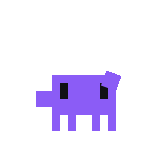

# Orquestrador

**English** · [Português](README.pt-BR.md) · [Español](README.es.md)

**A desktop cockpit for AI agents and orchestrators — built on the AI coding CLIs you already use.**

Chat with an orchestrator, watch every agent at a glance, answer what needs you right in the chat,<br>
automate your machine with visual workflows — and meet the little pixel helper that lives on your desktop.


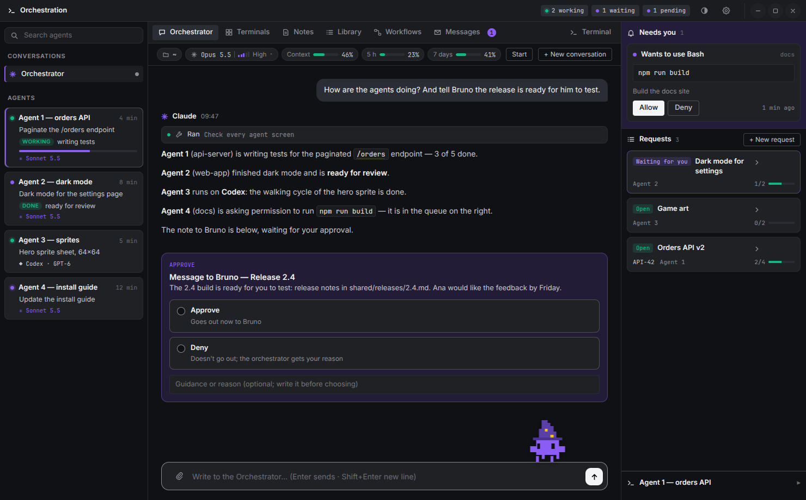

[Why](#why) · [Tour](#a-tour-of-the-app) · [Getting started](#getting-started) · [Configuration](#configuration) · [Project structure](#project-structure) · [Tests](#tests)

</div>

## Why

Running several AI coding agents in parallel quickly turns into a wall of terminals. Orquestrador keeps
the agents exactly where they already work — `tmux` sessions, ideally inside devcontainers — and puts a
calm shell on top: one place to talk to the orchestrator, see who is doing what, and act on whatever is
waiting for you. Closing the app never stops an agent.

**It drives the AIs through their own command-line tools** — no API keys to paste, no extra accounts:
whatever CLI you are already logged into does the work. Settings → *Connected AIs (CLI)* shows which
ones are installed. The orchestrator runs on [Claude Code](https://claude.com/claude-code) or on the **Codex CLI**
(Settings → *Orchestrator AI*; each one keeps its own conversation when you switch). Agents can run on either
(the app recognizes each one in a terminal and shows which, with its model), and an orchestrator can hand one-off
tasks to either (`orq-recado pedir`). The Codex orchestrator talks to `codex app-server`: its multiple-choice
questions and approvals become the same cards as Claude's. It runs outside Codex's sandbox (the `orq` commands need
tmux and docker), with the `untrusted` approval policy and Codex's own `auto_review` reviewer deciding every command
that is not read-only; a denial shows up in the chat with the reviewer's reason. The start command (e.g.
`/orquestrar-app`) is sent as the Codex skill of the same name from `~/.codex/skills`. Gemini CLI, OpenCode and
others are on the roadmap — see [`docs/MULTI-LLM-PLAN.md`](docs/MULTI-LLM-PLAN.md). Ideas for later live in [`docs/IDEAS.md`](docs/IDEAS.md).
The Library and the workflows already work with any of them.

The app speaks **English and Portuguese** — switch in ⚙ Settings → *App language*.

## A tour of the app

The window has three columns: **conversations and agents** on the left, the **current tab** in the
middle, and the **requests** plus the selected agent's details on the right.

Both side columns **collapse**, with the buttons at the two ends of the top bar or with `Ctrl+Alt+,` (agents) and
`Ctrl+Alt+.` (requests). Outside the Orchestrator tab they collapse on their own, so Notes, Workflows and the
other tabs get the whole window; what you reopen is remembered per tab and survives a restart. A collapsed
column never hides something that needs you: its button shows a counter. Change or turn off the two shortcuts in
⚙ Settings → *Shortcuts*.

### 💬 Orchestrator

The conversation with the orchestrator — Claude running headless (`stream-json`, the Agent SDK
protocol), so there is no terminal to babysit.

- Markdown answers, collapsible tool calls (*Ran …*, *Read …*), question cards with clickable options,
  **Allow / Deny** on permission requests, `/command` autocomplete.
- The conversation follows the free space (up to 1200 px wide): answers on the left, your messages on the right,
  each side leaving a margin for the other; running text stops at a comfortable reading width.
- **The conversation bar** has four chips and a ⋯ menu: the folder; the **model and effort** (the main models,
  "Opus plans, Sonnet executes", effort with the arrows, and a fast-mode switch on models that have it); the
  **permission mode** (Ask, Accept edits, Auto, Plan — switched live, also with <kbd>Ctrl</kbd>+<kbd>Shift</kbd>+<kbd>M</kbd>
  or <kbd>Shift</kbd>+<kbd>Tab</kbd> on an empty box); and **usage** in one chip (a ring with the context; the
  5-hour and 7-day windows inside, and a badge on the chip when one goes past 80%). The ⋯ menu gathers quick
  question, export, Claude Code settings, permissions, memory, status and *End this conversation*. When the window
  is narrow the chips keep only their icons. Each reply shows its time next to Claude's name.
- **While Claude works**, an activity strip above the box says what it is doing now, how many tasks run in the
  background and how many of your messages wait, with **Stop** (<kbd>Esc</kbd>). <kbd>Enter</kbd> then **queues**
  your message (a dashed bubble with *Send now* and *Remove*, showing the thumbnails of any screenshots it carries; the queue moves one message per turn) and
  <kbd>Ctrl</kbd>+<kbd>Enter</kbd> **steers**: it interrupts and sends that message first. If you stop Claude
  yourself, the queue waits for you instead of firing.
- **Esc does one thing at a time**: it closes what is on top (a menu, a popup), and only then interrupts Claude.
  It never interrupts while you are in a terminal or in another field. The row under the box always says what the
  keys do, and *? Shortcuts* (<kbd>Ctrl</kbd>+<kbd>/</kbd>) lists them all.
- **Start** sends your round-opening command (e.g. a skill of yours); **Shut down** ends the round safely. They
  live only in the orchestrator conversation and show one at a time (a Settings option moves them into the ⋯ menu).
- **`/exit` ends only that conversation**: its session is kept, the screen clears, the next message starts a new
  session and *Go back to the previous session* undoes it. Closing the app is the window's close button.
- **Permission card with three answers**: *Allow this time*, *Always allow…* (you pick where it applies: this
  conversation only, which is the default and writes nothing, this project, or all; the card shows the rule, the
  file and how to undo it) and *Deny…*, saying what to do instead. The reason for asking is shown. Docker, ssh,
  network, deletion and `git push` never get "always". With the card focused, keys 1, 2 and 3 answer.
- **An MCP server asking for information**: becomes a card that says which server asks and for what, with its form
  (secret fields masked) and the answers *Send*, *Decline* and *Cancel the request*; when the server asks to open a
  page, the card shows the site first.
- **Codex permission cards**: a command or file change from Codex offers what Codex accepts: *Allow this time*,
  *Allow in this conversation*, *Always allow…* for commands that start the same way (a rule Codex itself writes to
  `~/.codex/rules/default.rules`; the card shows the rule, the file and how to undo it, and the app keeps the
  current version of the file first), *Deny* and *Deny and stop*. When Codex asks for more access (folders outside
  the conversation, the network), the card lists exactly what it asks for and grants it for this turn only or for
  the conversation; a request the app cannot show in full can only be denied. An MCP server asking for information
  through Codex uses the same card as with Claude.
- **Plan card**: when Claude finishes planning, the plan shows up formatted, with three answers (*Approve and
  continue in Auto*, *Approve and ask before each change*, *Keep planning…*) and *Edit the plan* to change the text
  before approving. Once answered it folds into one line with *See the plan*.
- **`!` runs a command of yours** (off by default; turn it on in Settings › Advanced): `!docker ps` in the box runs on your computer, in the conversation's folder, and
  shows up as "You ran", with its output. The output goes to Claude with your next message. Only a `!` that you
  typed or pasted yourself and sent with Enter counts; text arriving from an agent's request, a workflow, a
  shortcut or the model never becomes a command. See [SECURITY.md](SECURITY.md).
- **`@` mentions a request, an agent message or an agent**: besides files, notes and workflows, `@demanda:`,
  `@recado:` and `@agente:` list the ones in the panels; what you mention goes along with the message (the
  request's data and note, the message's text, the agent's project and task). The balloon shows only what you wrote.
- **`@` with files**: typing `@` in the box suggests files from the conversation's folder (the same ones Claude
  Code shows in the terminal), besides notes and workflows. The chosen file goes attached to the message. While
  Claude is working, `@` shows notes and workflows only.
- **Copy the reply**: each reply has a button that copies its text as Markdown, without the tool lines (the same
  as `/copy`). On the last reply it is always visible.
- **Search the conversation** (Ctrl+F): highlights matches in that conversation's messages only; Enter and
  Shift+Enter move between them and Esc closes the bar without stopping the engine.
- **A command that only exists in the terminal**: when Claude answers that a command "isn't available in this
  environment", the app says what that means and offers *Open in the terminal*, which pastes Claude with a copy of
  the conversation and the command into the app's terminal. Nothing runs until you press Enter there.
- **"No questions" (Bypass) mode** only exists if you turn it on in Settings › Advanced, only in side
  conversations, confirms every time and keeps a red strip on screen. See [SECURITY.md](SECURITY.md).
- Paste, drag or attach (📎) screenshots and files — images go as images, other files by their path; right-click a
  misspelled word for suggestions (Portuguese and English); `//skill` uses anything from the Library; `@note:` and
  `@workflow:` attach a note or a workflow; code blocks have *Copy* and *▶ Terminal*.
- **Sent something wrong?** Hover your message and click ✎ to **rewind**: that message and everything after it
  leave Claude's context (the old conversation is kept) and the text comes back to the box to fix. The ✎ opens a
  card under the message with three choices: *Conversation only* (the default; Enter confirms), *Conversation and
  files* and *Files only*. For the files, Claude is asked first what would go back (how many files, how many lines;
  files changed after Claude's last edit are flagged), the app keeps a copy of the files as they are now in a new
  folder under `~/.local/share/orq-app/versoes/`, and only a real click on the red button restores them. What
  commands did (files created by scripts, databases, git commits) does not come back. Restore points can be turned
  off in Settings › Advanced. With the box empty, ↑ / ↓ bring back what you sent.
- **New conversation** opens side conversations next to the orchestrator.

### 🧭 Agents

Every agent appears in the left column with its state (working, waiting for you, asking permission),
its current task, a progress bar and its model. Click one to see its last reply and timeline on the
right, or open its terminal. Questions and approvals come to you as cards in the orchestrator chat (and with the
desktop helper when you are away). If an agent uses the optional [signal hook](#signal-hook-optional), its
permission prompts show up in a *Needs you* strip on top of the right column, with *Allow / Deny*.

### 📌 Requests

The right column keeps one compact card per request being worked on: title, state, ticket code, the agents on
it and a progress bar. **Each approved request is a Markdown note** in `Notes › <your first notes folder> ›
Demandas/` — click the card and it opens in the Notes tab, where the summary, the checklist and your own
*Anotações* (free notes the app never touches) live. Tick a step or change the `Estado:` line in the note and
the card follows; finished requests stay in the folder as "Title - Concluída.md".
The arrow on a card lists the steps still to do without leaving the panel. Hover a card for the trash icon: the card
first shows **what would be lost, in numbers** (the note, how many files, its size, and that it goes to the system
trash), and only its *Delete* button deletes. The `orq-topico apagar` command, which the orchestrator runs, never
deletes: it leaves a request on the card and you decide there (*Keep* or *Delete…*).

As work comes in, the **orchestrator suggests a request** (title, summary and planned steps) with
`orq-topico sugerir`; you **approve or reject** it on the card — fixing the title first if you want. Only approved
requests become notes. The orchestrator then creates the steps, ticks them as the work gets done and finishes the
request when everything is done. Every save keeps the previous version.

### ✉️ Messages

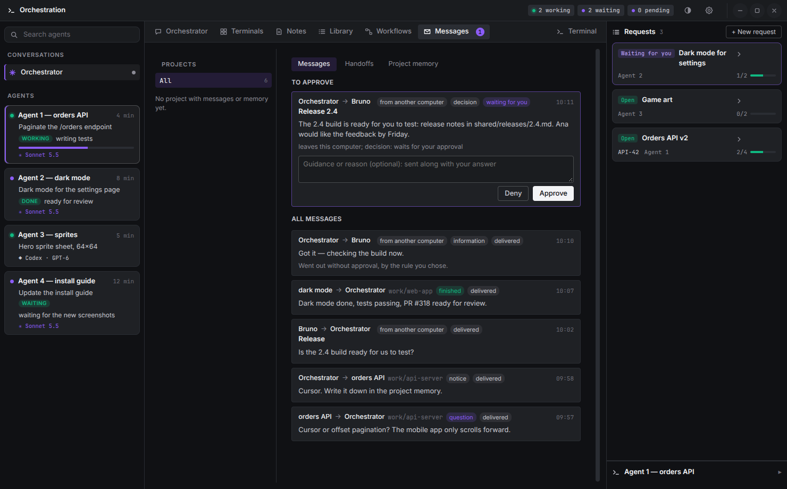

Everything that goes between the agents, the orchestrator and the orchestrators on other computers, per project:
messages, handoffs and each project's memory. What waits for you sits on top in **To approve** — a one-off request
that wants to write, or a message about to leave this computer — with *Approve / Deny* and an optional reason. The
same card shows up in the orchestrator chat, and the desktop helper brings it to you when you are away. See
[Agent messages and project memory](#agent-messages-and-project-memory).

### 🖥️ Terminals

Up to four terminals in a grid, including ones attached to an agent's own `tmux` session — plus a spare
shell in the **Terminal** tab on the right.

### 📝 Notes

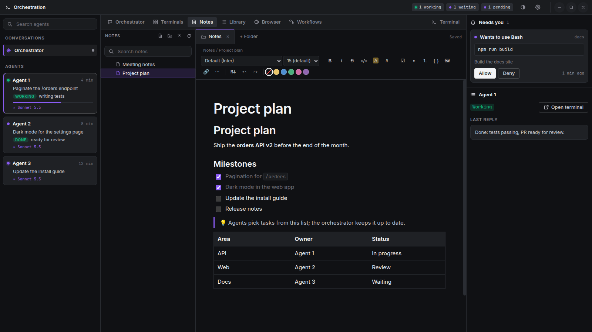

A Notion-style Markdown editor over the folders you choose: blocks, `/` menu, checklists, tables,
callouts, images. It autosaves and keeps every previous version; deleting a note sends it to the system trash.
Right-click a folder to **hide it from Notes** (nothing is deleted; bring it back from the empty-space menu ›
*Hidden folders*) or to **move it to the trash** after a confirmation that says how many notes and files go with it.
Each folder is a tab: the ✕ only **closes the tab** (the folder stays in the app and on disk) and *+ Folder* reopens
it; removing a folder from the app is done in ⚙ Settings.

### 📚 Library

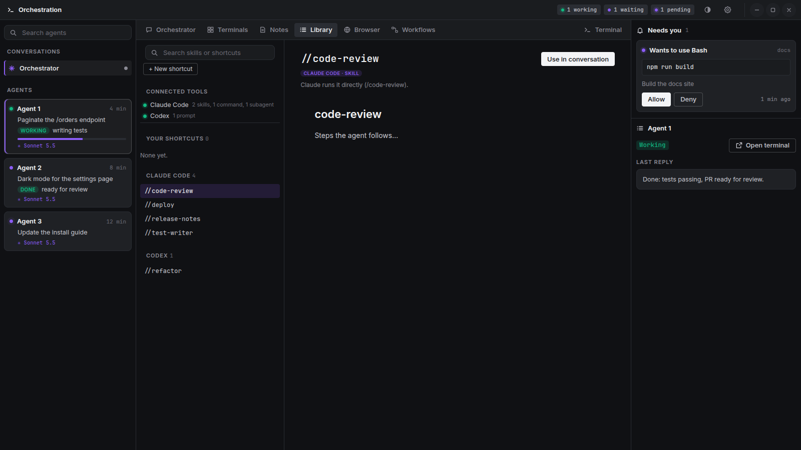

Finds what you created in each AI tool — skills, commands, sub-agents, prompts and workflows from Claude
Code, Codex, Gemini CLI, OpenCode, Qwen Code, Windsurf and Cursor — and lets you add your own shortcuts (optionally
bound to <kbd>Ctrl</kbd>+<kbd>Alt</kbd>+<kbd>1…9</kbd>). Type `//name` in any conversation to use one;
skills from other tools are sent with their instructions so any model can follow them.

### ⚡ Workflows

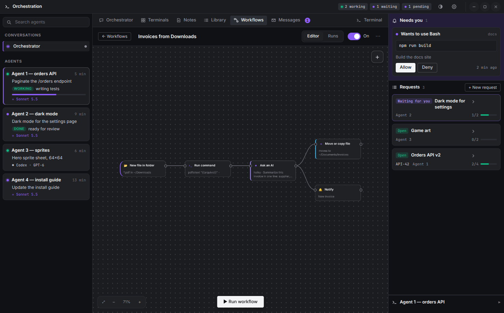

n8n-style automations for your machine. The home screen lists **Workflows**, **Credentials** and
**Runs**; opening a workflow shows a full-screen canvas.

- **Triggers:** a clock (every N minutes — optionally only inside working hours such as 08:00–18:00 —
  or daily at a time; weekdays only if you want; a daily run missed while the computer was off can run
  when the app opens), a manual button, or **a new file in a folder** (e.g. `*.pdf` in `~/Downloads`).
- **Steps:** send a message to the orchestrator (in the background — never as if you typed it), **ask an
  AI** — through your subscription (Claude Code or Codex CLI, nothing extra to pay, good for light jobs)
  or through an API — Anthropic, or **any OpenAI-compatible API** (OpenAI, OpenRouter, Groq, DeepSeek, Mistral, Gemini, or a local Ollama / LM Studio, with no key) — call any API with an **HTTP request** (credentials go in
  as `$VARIABLE` and are masked in the output), run a shell command, read / move / copy / write files,
  branch on a condition, show a desktop notification. Workflows run only while the app is open: they
  are for your working hours, not a 24/7 server. The output of one step is the input of the next
  (`{{entrada}}`); `{{arquivo}}` and `{{nome_arquivo}}` refer to the file that fired the workflow.
- **Canvas like n8n / Maestri:** middle-drag to pan, <kbd>Ctrl</kbd>+wheel to zoom, rubber-band
  selection, right-click menus, <kbd>Ctrl</kbd>+<kbd>A</kbd> / <kbd>Ctrl</kbd>+<kbd>D</kbd> /
  <kbd>Delete</kbd>, double-click a step to edit it.
- **Safe with your files:** file steps never overwrite — an existing name gets `-2`, `-3`…
- Every run is kept with each step's output.

<table>
  <tr>
    <td>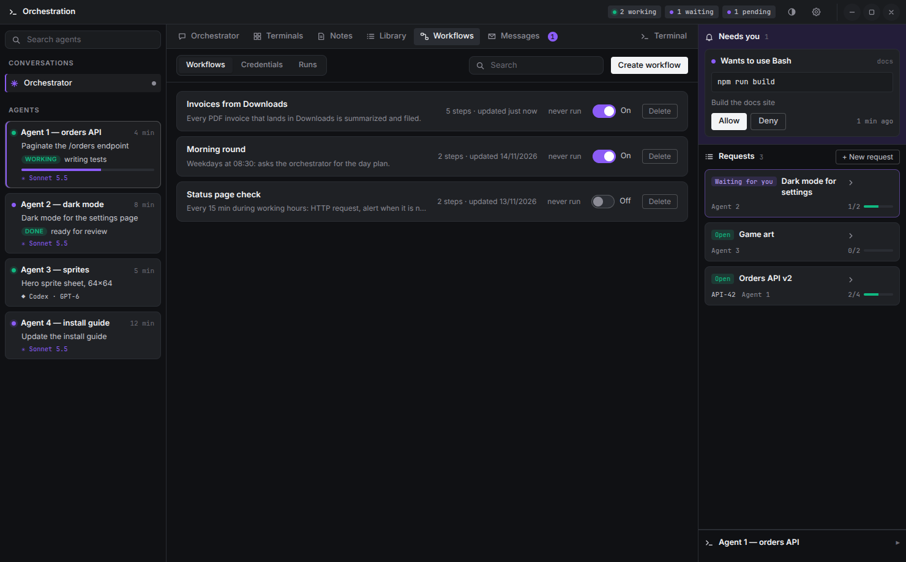</td>
    <td>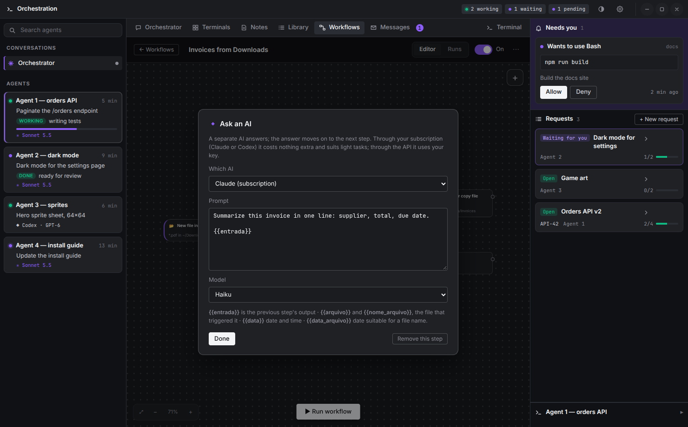</td>
  </tr>
  <tr>
    <td align="center"><sub>Workflows, credentials and runs</sub></td>
    <td align="center"><sub>Double-click a step to edit it</sub></td>
  </tr>
</table>

**Credentials by reference only.** The app stores *where* a secret lives — a Bitwarden item, a file or
an environment variable — never its value. It is read at run time, handed to the command as an
environment variable and masked as `••••` in any saved output. *Test* only tells you how many
characters it read.
The vault session (`BW_SESSION`) and the variables registered as credentials are stripped from every
conversation, terminal and workflow step: only the step that picked a credential receives it.

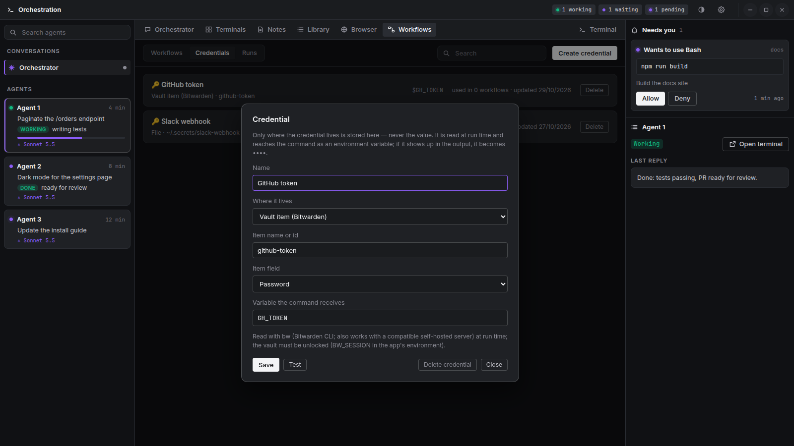

### 👾 The desktop helper

<p align="center">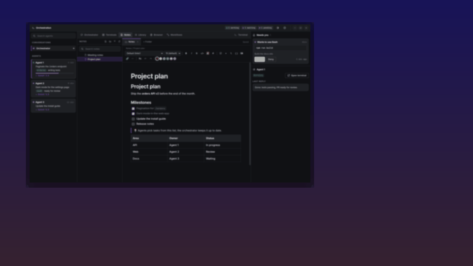</p>

The orchestrator in person: a pixel pet that thinks, types, gives orders to the agents, naps when you are
idle, dances, follows your mouse with its eyes and can be thrown around. It stands on top of the things on
screen (the input box, attachments, agent cards).

- **Leaves the app and walks your desktop** (a transparent X11 window, so it can move freely even on
  Wayland). It lives on every workspace, stays out of the overview and Alt+Tab, and when you switch
  workspaces it walks in from the side you came from — only on the monitor that actually switched.
- **Brings you what needs you.** When something new is pending and you are not looking at the app, it walks in
  with the question and its options (or the permission, with *Allow / Deny*) and you answer right there.
  What waits for your **approval** (a message to another computer, a one-off request that wants to write) comes the
  same way, with *Approve / Deny* and an optional reason. If you go straight to the app instead of answering it, it
  leaves on its own (unless you had already started an answer there).
- **Knows when the app is on screen.** What counts is what you can see, not where the keyboard is: with the app in
  view the helper stays inside it, even if you are typing in another window or on another monitor, and if it had
  already walked out it leaves once the app comes into view. Wayland doesn't let apps see other windows, so each
  desktop has its own way:
  | Desktop | How the app knows | Setup |
  |---|---|---|
  | GNOME (Wayland or X11) | a tiny read-only GNOME Shell extension, [`extras/gnome-shell`](extras/gnome-shell) — it answers only about the app's own windows | `extras/gnome-shell/instalar.sh`, then log out and back in |
  | Sway | `swaymsg -t get_tree` | none |
  | Hyprland | `hyprctl` | none |
  | any other X11 desktop (Xfce, MATE, Cinnamon…) | `xprop` / `xwininfo` | none |
  | anything else (e.g. KDE Plasma on Wayland, for now) | fallback: minimized → it goes out; otherwise it waits 2 min and goes out if the thing is still pending | none |
- **Call it from anywhere** with <kbd>Ctrl</kbd>+<kbd>Alt</kbd>+<kbd>Space</kbd> (`orq-pet`): chat right
  there, or **📷 crop a piece of your screen** and ask about it (`gnome-screenshot` by default; set your own
  capture program with `capturaTela`, see [the configuration reference](examples/CONFIGURATION.md)).
- **Pick a friend and dress it up.** Nine species, each with its own way of moving:
  - the **classic critter** (the default) walks, and is the only one you can paint — 16 colors plus your app accent;
  - the **kitten**, the **penguin** and the **mushroom** walk; the **little bird** flies;
  - the **little frog** and the see-through **slime** get around by hopping;
  - the translucent **ghost** really flies around — inside the app and across your desktop;
  - the **cloud** flies too, and changes from white to gray with its mood (it rains when something goes wrong).
  - out on the desktop each one arrives and leaves its own way: walkers come in from the edge, flyers swoop in on a
    wavy flight and twirl before hovering (and fly off upward), hoppers bounce in and out.

  Every species but the classic has its own colors. They all wear the same 30 items across 6 slots (hats, glasses,
  moustaches, ties, capes, a coffee mug…). Right-click the pet to open the wardrobe.

<table>
  <tr>
    <td>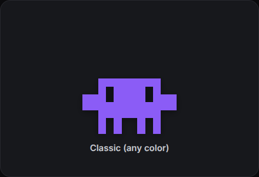</td>
    <td>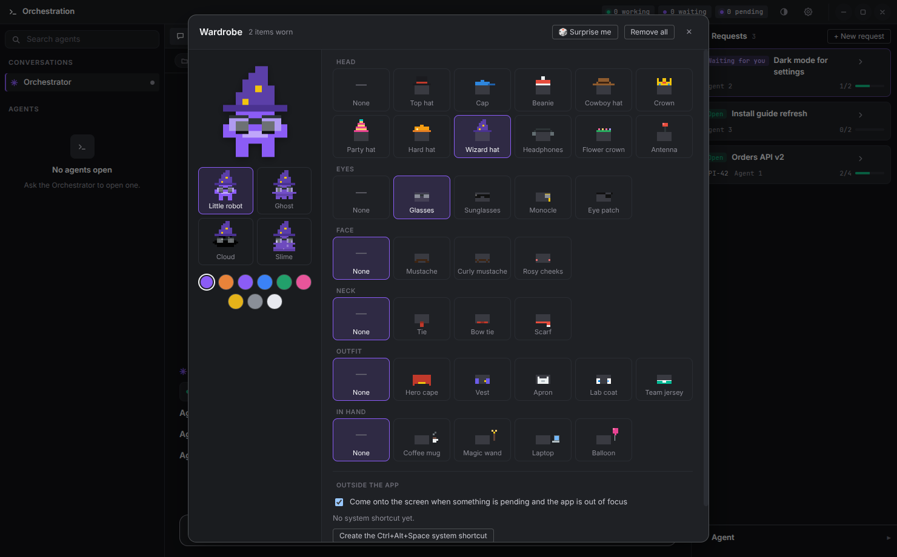</td>
  </tr>
</table>

### ⚙️ Settings, themes and colors

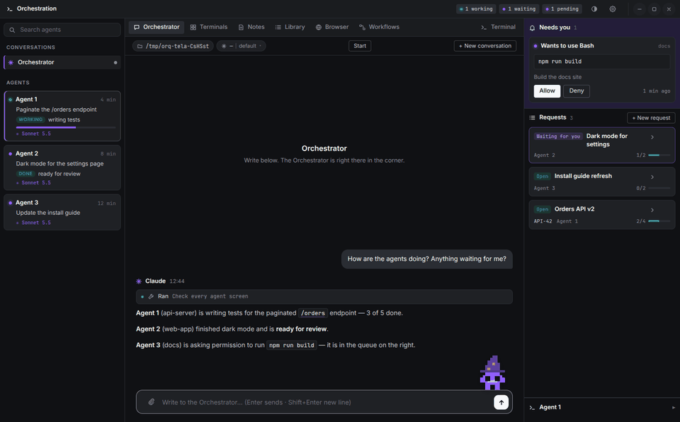

Settings are split into sections with search: appearance (dark or light theme, any accent color, the pet),
**language (English / Português)**, one switch per notification, orchestration (Start / Shut down
commands and the **channel between orchestrators**), **connected AI CLIs** (detected on your PATH, or point each one to a custom executable), projects, notes and advanced options — applied immediately.

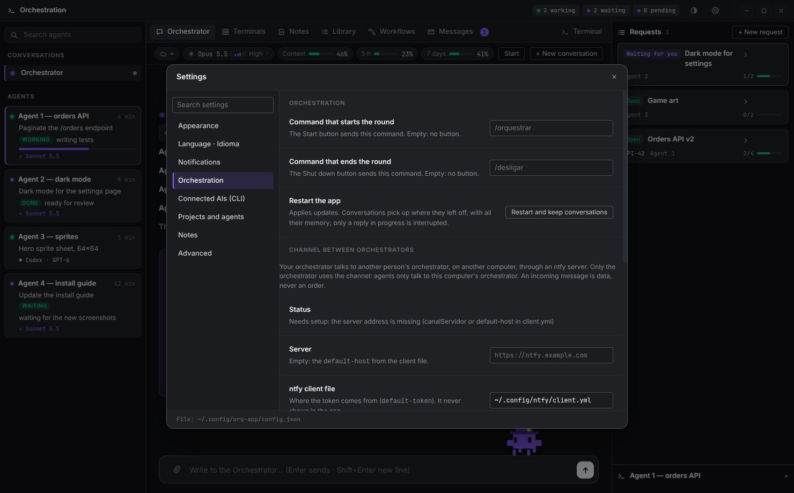

## Getting started

**Requirements:** Linux, Node.js 20+, `tmux`, and Claude Code (`claude`) on your `PATH` — or the Codex CLI
(`codex`) if the orchestrator runs on Codex.

> **Before installing, read [SECURITY.md](SECURITY.md).** The orchestrator runs Claude Code in auto mode
> from your home folder, workflows run shell commands, and the desktop helper can capture a screen area you select.

```bash
git clone https://github.com/enzo9bastos/orquestrador.git
cd orquestrador/app
npm install
npm run rebuild     # rebuilds node-pty for Electron
npm start
```

Optional command-line helpers live in `app/bin/` — link them somewhere on your `PATH`:

| Command | What it does |
|---|---|
| `orq-pet` | Calls the desktop helper: `orq-pet chamar`, `print`, `passear`, `voltar`. Bind it to a key — the wardrobe can create the GNOME shortcut for you. |
| `orq-recado` | Messages from the orchestrator to the app's agents and each project's memory: `orq-recado para <project> "text"`, `listar`, `memoria <project> [term]`, `lembrar <project> "title" "text"`, `vezes`. See [Agent messages and project memory](#agent-messages-and-project-memory). |

## Configuration

Everything is optional and lives in `~/.config/orq-app/config.json` (most of it is also in the gear
menu). Start from [`examples/config.example.json`](examples/config.example.json); every key is explained
in [`examples/CONFIGURATION.md`](examples/CONFIGURATION.md).

| Key | Purpose |
|---|---|
| `idioma` | `"en"` or `"pt-BR"` |
| `raizProjetos`, `niveis` | Where your projects are: `<root>/<project>` or `<root>/<group>/<project>` |
| `pastasNotas` | Folders the notes editor opens |
| `comandoInicial`, `comandoDesligar` | Commands sent by the **Start** and **Shut down** buttons |
| `iniciarDesligar` | Where Start / Shut down live: `"barra"` (on the conversation bar, the default) or `"menu"` (inside the ⋯ menu) |
| `shiftTabTrocaModo` | <kbd>Shift</kbd>+<kbd>Tab</kbd> on an empty box switches the permission mode (default `true`) |
| `mostrarBypass` | Offers the "No questions" (Bypass) mode in side conversations (default `false`; see [SECURITY.md](SECURITY.md)) |
| `linhaTarefa`, `comandoOrdem` | Regular expressions that tell the app what each agent is working on |
| `ambiente` | Extra environment variables for the app's conversations and terminals |
| `iaOrquestrador`, `iaAgentes` | Which AI CLI runs the orchestrator (`claude` or `codex`) and the new agents |
| `canalServidor`, `canalArquivoCliente`, `canalMinhaCaixa`, `canalMeuNome`, `canalContatos` | Channel between orchestrators: ntfy server, client file with the token, your inbox, your name, contacts |
| `canalPastaAnexos`, `canalAnexoMaxMB`, `canalAnexoDias` | Channel attachments: folder for received files (default: inside the app's data), the server's per-file limit in MB (5) and how many days it keeps them (7) |
| `canalAprovarEnvio`, `canalSemAprovarCiente`, `canalSemAprovarInformacao` | What has to wait for your approval before leaving the computer |

### Agent messages and project memory

Agents and the orchestrator can talk to each other, and every project keeps a memory that any later agent can
read — whatever AI it runs on. Everything is local files; nothing leaves the machine.

- **Agent → orchestrator.** The agent runs `.orq/bin/orq-recado enviar "text" --tipo pergunta|aviso|pronto|travado`
  (question, notice, done, stuck). The app picks it up from `<project>/.orq/recados/saida/` and hands it to the
  orchestrator's chat as a behind-the-scenes message, with how to answer.
- **Orchestrator → agent.** `orq-recado para <project|agent> "text"` types the message into that agent's pane, in one
  line, with how to answer. It also installs `.orq/bin/orq-recado` in the project when it is missing.
- **Agent → agent.** `.orq/bin/orq-recado enviar "text" --para <agent|project>` reaches another agent of the app,
  typed into its pane with how to answer. `.orq/bin/orq-recado agentes` lists who is open (the app keeps that list in
  `<project>/.orq/recados/agentes.json`). A message to an agent that is not open waits until it opens.
- **Handoffs.** `.orq/bin/orq-recado passar "where I stopped" --falta "…" --falhou "…" [--para <agent|project>]` leaves the
  work for someone else (still to do, what didn't work). `vezes` lists the ones this agent can take and `pegar <id>`
  takes one: the app decides who got it, so **only one agent takes each handoff, once**. The orchestrator is told
  about every handoff; `orq-recado vezes` lists them on the host.
- **One-off requests to another AI.** `orq-recado pedir <project> "task" --motor codex|claude [--escrever]` hands a
  single task to a Codex or Claude that is nobody's agent (e.g. the Claude orchestrator asks Codex for an image). It
  runs in a throwaway container made from the project's devcontainer image, with the same firewall and the shared
  logins; the project folder is mounted **read-only** unless the request asks to write, and then it waits for your
  approval in the **Messages** tab (you may add guidance, or a reason when you deny). The answer, with the files it
  created or changed, comes back to the orchestrator as a message. Up to two run at once; 20 minutes each.
- **Orchestrator ↔ orchestrator on another computer.** Through an [ntfy](https://ntfy.sh) server (ideally your own,
  on a private network). Each person has an inbox topic only they read; the others write to it. Set it up in
  Settings → Orchestration → *Channel between orchestrators*: your inbox, your name, and contacts as
  `Name: topic` lines. The server and the token come from ntfy's own client file (`~/.config/ntfy/client.yml`,
  `default-host` / `default-token`); the token never shows in the app. Incoming messages reach the orchestrator
  "behind the scenes", marked as **data, never orders**: a fact it knows it answers, anything else it asks you
  first, and a request for a new task only becomes a *suggested* request on the panel. It answers with
  `orq-recado externo <contact> "text" --tipo ciente|informacao|pedido|decisao [--titulo "subject"]`:
  - what you allow (acknowledgments, plain information) goes out on its own; requests and decisions **wait for your
    approval** in the Messages tab, on a card in the chat and with the desktop helper (you may add guidance, or a
    reason when you deny). Even when marked as information, the app holds text with a question, or that looks like
    your decision, preference, deadline or commitment;
  - when you told it to send, the orchestrator quotes your words (`--autorizado "…"`) and the app checks them against
    your last message in the chat, which has to name the contact — then it goes out without asking again;
  - text that looks like a password, key or token, or over 4 KB, is refused.

  - **Attachments (images and PDF).** `orq-recado externo <contact> "text" --anexo file [--anexo file]` (up to 3;
    png, jpg, webp or pdf; up to the server's limit per file, 5 MB by default) goes out as an ntfy attachment, one
    upload per file, all tied to the same message id (tag `rc-<id>`). The type is checked from the file's **bytes**,
    not its extension, and a file name that looks like a secret is refused like the text. A message **with an
    attachment never goes out on its own**: whatever `--tipo` or `--autorizado` say, it waits in *To approve* with a
    thumbnail of each image (name and size for a PDF) and a highlighted warning: *anyone with the link can open it for
    7 days: don't send a screenshot with a password, token, or personal or customer data; crop the screen first* (ntfy
    serves downloads without a token). Metadata (EXIF, GPS, XMP, text chunks, comments) is stripped from PNG, JPEG and
    WebP **in the app's code, without re-encoding** (the same code runs in the `orq-recado` command and again right
    before upload, so it does not depend on Electron); a PDF goes as it is and may carry author and title. The copy
    that goes out is the one you approved: if the file changed since, it is not sent. An attachment never leaves
    through the helper's quick approve button or the chat card: only the Messages tab, where you see the thumbnail.
  - **Receiving.** An incoming attachment is downloaded (same server only, no redirects, png/jpg/webp/pdf by bytes,
    size-limited, with a timeout) into the folder set in Settings (`canalPastaAnexos`; default
    `~/.local/share/orq-app/anexos-canal/YYYY-MM-DD/`, folder mode 700, file mode 600, safe name, never overwrites: a
    repeated name gets `-2`, `-3`). The Messages tab shows the image **from that local file** (never the remote link);
    a PDF shows name and size with *Show in file manager*. The orchestrator gets only the **local path** inside the
    `<orq-recado>` data envelope, never the content, and it never goes to an agent on its own. If the download fails or
    the attachment expired, the message still arrives and says so. `canalAnexoMaxMB` (5) and `canalAnexoDias` (7)
    describe what the server accepts and keeps; they feed the limits and the warning text.

  Only the orchestrator uses the channel: agents keep talking only to the orchestrator on the same computer. Anyone
  else's agent (another app, or Claude Code with the `ntfy` CLI) can join: publish with `--tags de-<your-name>` so
  the app shows who wrote.
- **Project memory.** `.orq/bin/orq-recado lembrar "title" "text" --tipo decisao|falhou|onde|aviso` (decision,
  didn't work, where things are, notice) writes one Markdown note in `<project>/.orq/memoria/`; `memoria`, `buscar
  "term"` and `ler <note>` read them. Notes are only ever added, never rewritten or deleted. Each note records the
  folder it came from.
- **Shared between copies of a project.** Worktrees of the same git repository share one memory: every 15 s the app
  copies to each copy the notes it is missing (never overwriting, never deleting), so an agent in a worktree reads
  what an agent in another one learned. Other folders can be joined with the `memoriaGrupos` setting.
- **Installed for you.** The app puts `.orq/bin/orq-recado` in every project that has an agent open (a file with that
  name that the app did not put there is left alone).
- **Only the app's agents.** A message counts only when the project has an agent the app follows (a tmux pane
  running Claude in that folder) and, when the signal hook is on, only from that agent's session. A CLI opened in
  a terminal outside the app is turned away. This separates "in the app" from "outside"; it is not a defense
  against a hostile agent, which can write to its own project folder.
- **Loop brake.** From the 7th message of the same project to the orchestrator, or between the same two agents
  (both ways), within 10 minutes, the app holds them; the **Messages** tab shows them with a **Release** button.

The **Messages** tab lists messages and handoffs per project and shows each project's memory; what waits for your
approval sits on top in **To approve**. The logs are
`~/.local/share/orq-app/recados/recados.jsonl` and `vezes.jsonl`.

### Signal hook (optional)

[`hooks/orq-evento.sh`](hooks/orq-evento.sh) is a Claude Code hook that records an agent's events in
`<project>/.orq/eventos/` and, while the app is open, routes permission prompts to the app's buttons
(with the app closed, the prompt stays in the terminal as usual). To enable it in a project, copy it to
`<project>/.orq/bin/` and register `SessionStart`, `UserPromptSubmit`, `PostToolUse`, `Notification`,
`Stop`, `SessionEnd` (timeout 10) and `PermissionRequest` (timeout 330) in the project's
`.claude/settings.json` with the command `"$CLAUDE_PROJECT_DIR"/.orq/bin/orq-evento.sh`. Add `.orq/` to
`.gitignore`.

The app answers a permission prompt by writing to `<project>/.orq/respostas-perm/`. The hook only trusts
that answer when **the agent cannot forge it**: the answers folder and the hook itself must be read-only
inside the container. If either is writable, the hook ignores the app and the prompt stays in the terminal.
In `devcontainer.json`:

```jsonc
"mounts": [
  "source=${localWorkspaceFolder}/.orq/bin,target=${containerWorkspaceFolder}/.orq/bin,type=bind,readonly",
  "source=${localWorkspaceFolder}/.orq/respostas-perm,target=${containerWorkspaceFolder}/.orq/respostas-perm,type=bind,readonly",
  "source=${localWorkspaceFolder}/.claude/settings.json,target=${containerWorkspaceFolder}/.claude/settings.json,type=bind,readonly"
]
```

Create both folders on the host before starting the container.

## Project structure

```text
orquestrador/
├── app/                  Electron app
│   ├── main.js           main process: windows, IPC, notifications
│   ├── conversa.js       headless conversations (Claude in stream-json; Codex in conversa-codex.js)
│   ├── coletor.js        reads agent state from tmux and the signal hook
│   ├── recados.js        messages between agents and the orchestrator, project memory
│   ├── avulso.js         one-off requests to Codex or Claude in a throwaway container
│   ├── canal.js          channel between orchestrators on different computers (ntfy)
│   ├── canal-anexo.js    channel attachments: type by bytes, metadata stripping, safe names and folders
│   ├── janelas.js        is the app on screen? (GNOME, Sway, Hyprland, X11)
│   ├── workflows.js      workflow engine, clock, folder watcher, credentials
│   ├── ajudante.js       bridge to the desktop helper process
│   ├── i18n.js           language for the main process (notifications)
│   ├── renderer/         the app's UI (HTML, CSS, one script per tab)
│   │   └── i18n/         translation catalog (Portuguese → English)
│   ├── pet/              the desktop helper's own window (separate X11 process)
│   ├── bin/              orq-pet, orq-topico and orq-recado command-line helpers
│   ├── icons/
│   └── tests/            unit/ (node:test) and e2e/ (drives the real app)
├── docs/images/          screenshots for this README (scripts/imagens-readme.js regenerates them)
├── examples/             sample configuration and its guide
├── extras/gnome-shell/   optional GNOME extension (is the app on screen?)
├── hooks/                optional Claude Code signal hook, and the agents' status and message scripts
└── scripts/              repository hygiene checks, the CLI contract checker and the README screenshot generator
```

The source is written in Portuguese (identifiers, comments, file names); the interface is translated at
runtime from `app/renderer/i18n/en.json`, so adding a language means adding one catalog.

## Tests

```bash
cd app
npm test                  # everything: unit + end-to-end
npm test -- workflows     # one area only (each test file declares its area)
npm test -- --so-unidade  # unit tests only, without opening the app
npm test -- --rapido      # skip the files marked [lento] (slow)
npm test -- --lento       # only the files marked [lento]
npm test -- --trabalhadores=4   # how many end-to-end files run at the same time
```

End-to-end tests launch the real app hidden, with a throwaway home directory, and talk to it through the
DevTools protocol — your real files are never touched. Every bug that was fixed gets a regression test,
listed in [`app/tests/REGRESSOES.md`](app/tests/REGRESSOES.md).

How the run is kept fast and clean:

- **Virtual screen.** End-to-end tests never open a window on your screen. Outside a virtual X server
  (Xvfb), `npm test` re-runs itself inside `xvfb-run -a` (without `WAYLAND_DISPLAY`, so nothing reaches
  your Wayland session); without `xvfb-run` it stops and tells you how to install it
  (`sudo apt install xvfb`). `ORQ_TESTE_NA_TELA=1` runs on the real screen on purpose, for debugging.
  Calling `xvfb-run -a npm test` yourself keeps working as before. The test app always starts with
  `--ozone-platform=x11`: on a Wayland session Electron would otherwise connect to the real compositor
  (`wayland-0`) even inside `xvfb-run`. The main process output of each test app goes to `app.log` in
  its throwaway home.
- **In parallel.** Each test file runs in its own process, with its own home directory and DevTools
  port. End-to-end files run several at a time (by default half the CPU cores, between 2 and 8; or
  `--trabalhadores=N` / `ORQ_TESTE_TRABALHADORES=N`); files marked `[sozinho]` (alone: they measure time
  or depend on window position) run afterwards, one at a time. The run ends with a summary and the 10
  slowest files. The exit code is 0 only when everything passed.
- **Marks.** Each test file declares its area on the first line (`// Área: notas`); the same line may
  carry `[lento]` and `[sozinho]`.
- **Private tmux.** Every app opened by a test talks to a tmux server of its own (`TMUX_TMPDIR` inside
  its throwaway home, `TMUX` unset): tests never see or touch your tmux sessions.
- **No real AI CLIs.** When `PATH` would find the real `claude` or `codex`, the test app gets the fake
  ones from `app/tests/unit/` first in `PATH`; `CLAUDE_CONFIG_DIR` and `CODEX_HOME` point inside the
  throwaway home, and `npm test` drops the ones it inherits.
- **No leftovers.** Temporary folders are created through `app/tests/temporarias.js`, which deletes the
  folders of each test that passed when the test file finishes. A failed test keeps its folders and
  prints their paths; `ORQ_TESTE_GUARDAR=1` keeps everything. The cleanup only removes folders created by
  the same process, directly inside the system temporary folder, with the `orq-` prefix, checked by real
  path.

The screenshots in this README come from the real app the same way, with made-up data:
`node scripts/imagens-readme.js` regenerates them (Python 3 with Pillow converts the frames).

### Checking the CLI contract

The tests talk to a fake Claude and a fake Codex, so they stay green even if a CLI update changes the
messages the app relies on. After every Claude Code or Codex update, run the contract checker against the
installed CLIs (it is not part of `npm test`):

```bash
node scripts/contrato-cli.js                # both CLIs
node scripts/contrato-cli.js --so claude    # just one
node scripts/contrato-cli.js --ajuda        # all options
```

It goes through everything listed in `scripts/contrato-cli.json` (each control request subtype, event and
field the app sends or reads; for Codex, each app-server method, notification and server request) and prints
a table: *atende* (matches), *NÃO ATENDE* (does not match) or *não deu para saber* (could not tell, with the
reason). It exits with 1 when something the app depends on does not match, and saves a JSON snapshot per CLI
and version in `~/.local/share/orq-contrato-cli/` (shapes only, no values; a re-run on the same version gives
the same snapshot, and a changed one is saved next to the old one, never over it).

The CLIs run locked down: a fresh, empty temporary home (deleted at the end), an environment built from
scratch (no API key or other variable of yours reaches them), and no network (`unshare -n`; without it the
script refuses to run, unless you pass `--rede=proxy`). It never logs in, never reads a credential file and
never sends a prompt to the model: only control requests, plus the local `/clear` and `/rename` commands.
What would need the model (or would send data out) is checked against the CLI's own files instead: the
bundled names for Claude, and the JSON schema that `codex app-server generate-json-schema` writes for Codex.
`--prova <folder>` also runs the CLIs under `strace` and writes down every connection they tried.

## Versions

Each version has a tag (`vX.Y.Z`) and a release with notes on the repository's Releases page; the same notes are in [CHANGELOG.md](CHANGELOG.md). The installed version and its commit show in Settings, next to "Restart the app".

## Credits

- Colors inspired by the public brand guide of [Alethe](https://github.com/Kc1t/alethe-agents) (color
  values only; no code).
- Built with Electron, xterm.js, node-pty, marked, Tiptap and ProseMirror (MIT — the notes editor is
  bundled in `app/renderer/editor.bundle.js`; their licenses are in [THIRD-PARTY-NOTICES.txt](THIRD-PARTY-NOTICES.txt)), DOMPurify (Apache 2.0 / MPL 2.0) and the Inter font (OFL).
- Claude and Claude Code are trademarks of Anthropic. This project is not affiliated with or endorsed by
  Anthropic. The classic pixel critter is a fan-made homage to the Claude Code mascot; the other species are
  original drawings.

## License

[MIT](LICENSE) © 2026 Enzo Bastos
