<div align="center">

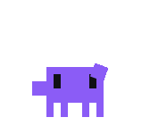

# Orquestrador

[English](README.md) · **Português** · [Español](README.es.md)

**Uma cabine de comando no desktop para agentes e orquestradores de IA — feita sobre as CLIs de IA para programação que você já usa.**

Converse com um orquestrador, veja todos os agentes de relance, responda na própria conversa o que precisa de você,<br>
automatize o seu computador com workflows visuais — e conheça o pequeno ajudante em pixel que mora no seu desktop.


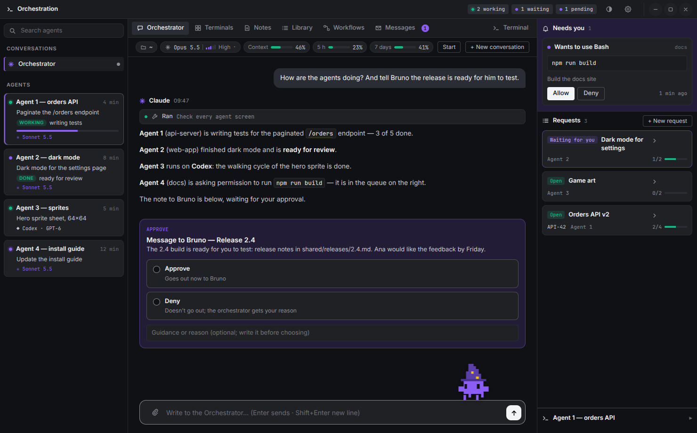

[Por que](#por-que) · [Passeio](#um-passeio-pelo-app) · [Primeiros passos](#primeiros-passos) · [Configuração](#configuração) · [Estrutura](#estrutura-do-projeto) · [Testes](#testes)

</div>

## Por que

Rodar vários agentes de IA em paralelo vira rápido uma parede de terminais. O Orquestrador deixa os agentes
exatamente onde já trabalham — sessões do `tmux`, de preferência dentro de devcontainers — e põe por cima uma
casca tranquila: um lugar para falar com o orquestrador, ver quem está fazendo o quê e agir no que está
esperando por você. Fechar o app nunca para um agente.

**Ele conduz as IAs pelas próprias ferramentas de linha de comando** — sem colar chave de API, sem conta a mais:
a CLI em que você já está logado faz o trabalho. Configurações → *IAs conectadas (CLI)* mostra quais estão
instaladas. O orquestrador roda no [Claude Code](https://claude.com/claude-code) ou no **Codex CLI**
(Configurações → IA do orquestrador; cada um guarda a própria conversa quando você troca). Os agentes podem rodar
em qualquer um dos dois (o app reconhece cada um no terminal e mostra qual é, com o modelo), e um orquestrador pode
passar tarefas avulsas a qualquer um deles (`orq-recado pedir`). O orquestrador Codex conversa com o
`codex app-server`: as perguntas com opções e os pedidos de aprovação viram os mesmos cartões do Claude. Ele roda
fora do sandbox do Codex (os comandos `orq` precisam de tmux e docker), com a política de aprovação `untrusted` e o
revisor `auto_review` do próprio Codex decidindo todo comando que não é só leitura; uma recusa aparece na conversa
com o motivo do revisor. O comando de início (por exemplo `/orquestrar-app`) vai como a skill do Codex de mesmo nome,
em `~/.codex/skills`. Gemini CLI, OpenCode e outros estão nos planos — veja
[`docs/MULTI-LLM-PLAN.md`](docs/MULTI-LLM-PLAN.md). Ideias para depois ficam em [`docs/IDEAS.md`](docs/IDEAS.md).
O Repertório e os workflows já funcionam com qualquer um deles.

O app fala **inglês e português** — troque em ⚙ Configurações → *Idioma do app*.

## Um passeio pelo app

A janela tem três colunas: **conversas e agentes** à esquerda, a **aba atual** no meio e as **demandas** mais os
detalhes do agente escolhido à direita.

As duas colunas laterais **recolhem**, pelos botões nas duas pontas da barra de cima ou por `Ctrl+Alt+,` (agentes) e
`Ctrl+Alt+.` (demandas). Fora da aba do Orquestrador elas recolhem sozinhas, e Notas, Workflows e as outras abas
ficam com a janela inteira; o que você reabre fica lembrado por aba e sobrevive a reiniciar. Coluna recolhida nunca
esconde algo que precisa de você: o botão dela mostra um contador. Troque ou desligue os dois atalhos em
⚙ Configurações → *Atalhos*.

### 💬 Orquestrador

A conversa com o orquestrador — o Claude rodando sem terminal (`stream-json`, o protocolo do Agent SDK), então não
há terminal para vigiar.

- Respostas em Markdown, chamadas de ferramenta recolhíveis (*Rodou …*, *Leu …*), cartões de pergunta com opções
  clicáveis, **Permitir / Negar** nos pedidos de permissão, autocompletar de `/comando`.
- A conversa acompanha o espaço livre (até 1200 px de largura): respostas à esquerda, suas mensagens à direita,
  cada lado deixando uma margem para o outro; o texto corrido para numa largura confortável de leitura.
- Troca de modelo e de esforço, medidores de contexto e de uso (janelas de 5 horas e de 7 dias) na barra de cima;
  cada resposta mostra o horário ao lado do nome do Claude (com a data quando é de outro dia).
- **Iniciar** manda o seu comando de abertura da rodada (por exemplo, uma skill sua); **Desligar** encerra a rodada
  com segurança.
- Cole, arraste ou anexe (📎) prints e arquivos — imagens vão como imagem, outros arquivos pelo caminho; clique com o
  botão direito numa palavra errada para ver sugestões (português e inglês); `//skill` usa qualquer coisa do
  Repertório; `@note:` e `@workflow:` anexam uma nota ou um workflow; blocos de código têm *Copiar* e *▶ Terminal*.
- **Mandou algo errado?** Passe o mouse na sua mensagem e clique em ✎ para **voltar**: aquela mensagem e tudo o que
  veio depois saem do contexto do Claude (a conversa antiga fica guardada) e o texto volta para a caixa para corrigir.
  Com a caixa vazia, ↑ / ↓ trazem de volta o que você mandou.
- **Nova conversa** abre conversas paralelas ao lado do orquestrador.

### 🧭 Agentes

Cada agente aparece na coluna da esquerda com o estado (trabalhando, esperando você, pedindo permissão), a tarefa
atual, uma barra de progresso e o modelo. Clique em um para ver a última resposta e a linha do tempo à direita, ou
abra o terminal dele. Perguntas e aprovações chegam a você como cartões na conversa do orquestrador (e com o
ajudante do desktop quando você está longe). Se um agente usa o [hook de sinais](#hook-de-sinais-opcional) opcional,
os pedidos de permissão dele aparecem numa faixa *Precisa de você* no topo da coluna da direita, com *Permitir /
Negar*.

### 📌 Demandas

A coluna da direita mantém um cartão compacto por demanda em andamento: título, estado, código do ticket, os agentes
nela e uma barra de progresso. **Cada demanda aprovada é uma nota em Markdown** em `Notas › <sua primeira pasta de
notas> › Demandas/` — clique no cartão e ela abre na aba Notas, onde ficam o resumo, o checklist e as suas
*Anotações* (notas livres que o app nunca mexe). Marque uma etapa ou mude a linha `Estado:` da nota e o cartão
acompanha; demandas concluídas ficam na pasta como "Título - Concluída.md".
A seta do cartão lista as etapas que faltam sem sair do painel. Passe o mouse no cartão para ver a lixeira: depois de
um segundo clique a demanda sai do painel e a nota vai para a lixeira do sistema.

Conforme o trabalho chega, o **orquestrador sugere uma demanda** (título, resumo e etapas previstas) com
`orq-topico sugerir`; você **aprova ou recusa** no cartão — se quiser, corrigindo o título antes. Só demandas aprovadas
viram nota. Depois o orquestrador cria as etapas, marca conforme o trabalho anda e conclui a demanda quando tudo
termina. Cada gravação guarda a versão anterior.

### ✉️ Recados

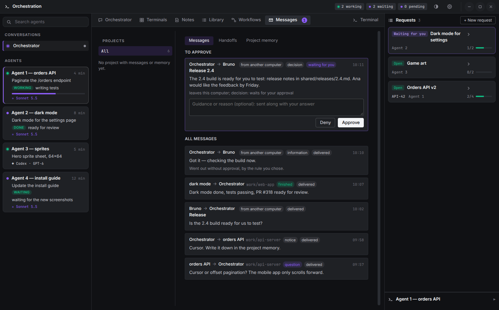

Tudo o que passa entre os agentes, o orquestrador e os orquestradores de outros computadores, por projeto: recados,
vezes passadas e a memória de cada projeto. O que espera você fica em cima, em **Para aprovar** — um pedido avulso
que quer gravar, ou um recado prestes a sair deste computador —, com *Aprovar / Negar* e um motivo opcional. O mesmo
cartão aparece na conversa do orquestrador, e o ajudante do desktop traz até você quando você está longe. Veja
[Recados dos agentes e memória do projeto](#recados-dos-agentes-e-memória-do-projeto).

### 🖥️ Terminais

Até quatro terminais em grade, inclusive ligados à sessão `tmux` de um agente — mais um shell de reserva na aba
**Terminal**, à direita.

### 📝 Notas

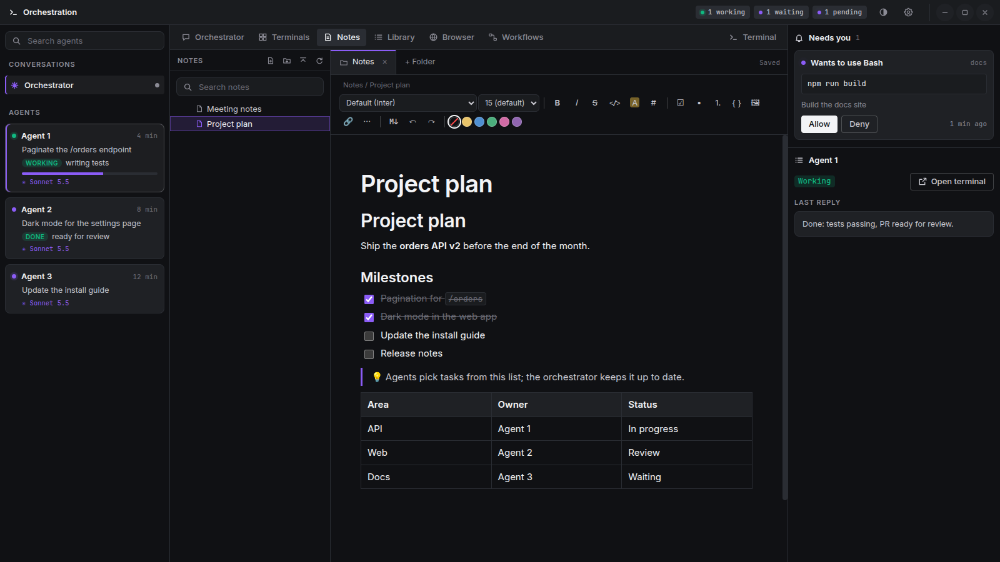

Um editor de Markdown no estilo Notion sobre as pastas que você escolher: blocos, menu `/`, checklists, tabelas,
destaques, imagens. Grava sozinho e guarda todas as versões anteriores; apagar uma nota manda para a lixeira do
sistema. Clique com o botão direito numa pasta para **escondê-la das Notas** (nada é apagado; traga de volta pelo
menu do espaço vazio › *Pastas escondidas*) ou para **mandá-la para a lixeira**, depois de uma confirmação que diz
quantas notas e arquivos vão junto. Cada pasta é uma aba: o ✕ só **fecha a aba** (a pasta continua no app e no disco) e
o *+ Pasta* reabre; tirar uma pasta do app é nas ⚙ Configurações.

### 📚 Repertório

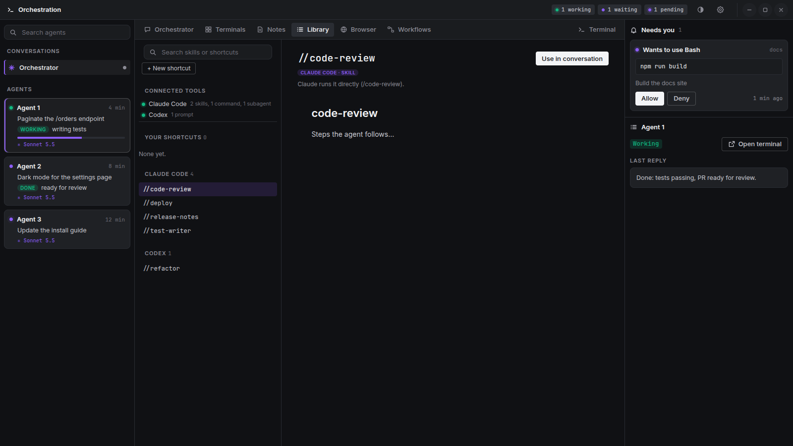

Acha o que você criou em cada ferramenta de IA — skills, comandos, subagentes, prompts e workflows do Claude Code,
Codex, Gemini CLI, OpenCode, Windsurf e Cursor — e deixa você criar os seus próprios atalhos (se quiser, ligados a
<kbd>Ctrl</kbd>+<kbd>Alt</kbd>+<kbd>1…9</kbd>). Digite `//nome` em qualquer conversa para usar um; skills de outras
ferramentas vão com as instruções delas, para qualquer modelo conseguir seguir.

### ⚡ Workflows

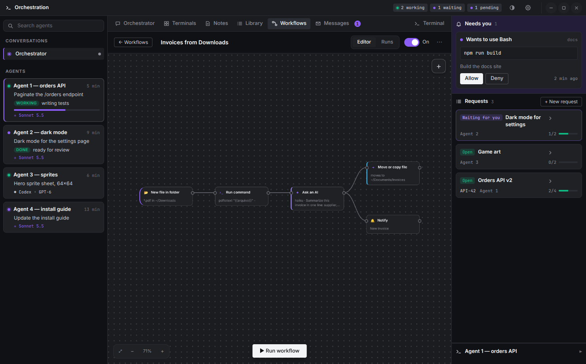

Automações no estilo do n8n para o seu computador. A tela inicial lista **Workflows**, **Credenciais** e
**Execuções**; abrir um workflow mostra uma tela inteira de edição.

- **Gatilhos:** um relógio (a cada N minutos — se quiser, só dentro do expediente, como 08:00–18:00 — ou todo dia
  num horário; só em dias úteis, se quiser; uma execução diária perdida com o computador desligado pode rodar quando o
  app abrir), um botão manual, ou **um arquivo novo numa pasta** (por exemplo `*.pdf` em `~/Downloads`).
- **Passos:** mandar uma mensagem ao orquestrador (por trás — nunca como se você tivesse digitado), **perguntar a uma
  IA** — pela sua assinatura (Claude Code ou Codex CLI, sem custo extra, bom para tarefas leves) ou por uma API —
  Anthropic, ou **qualquer API compatível com OpenAI** (OpenAI, OpenRouter, Groq, DeepSeek, Mistral, Gemini, ou um
  Ollama / LM Studio local, sem chave) —, acionar qualquer API com uma **requisição HTTP** (credenciais entram como
  `$VARIAVEL` e ficam mascaradas na saída), rodar um comando de shell, ler / mover / copiar / gravar arquivos, decidir
  por uma condição, mostrar uma notificação no desktop. Os workflows só rodam com o app aberto: são para o seu
  expediente, não um servidor 24/7. A saída de um passo é a entrada do próximo (`{{entrada}}`); `{{arquivo}}` e
  `{{nome_arquivo}}` são o arquivo que disparou o workflow.
- **Tela de edição como no n8n / Maestri:** arraste com o botão do meio para mover, <kbd>Ctrl</kbd>+roda para zoom,
  seleção por retângulo, menus no botão direito, <kbd>Ctrl</kbd>+<kbd>A</kbd> / <kbd>Ctrl</kbd>+<kbd>D</kbd> /
  <kbd>Delete</kbd>, clique duplo num passo para editar.
- **Cuidadoso com os seus arquivos:** passos de arquivo nunca sobrescrevem — um nome que já existe ganha `-2`, `-3`…
- Toda execução fica guardada, com a saída de cada passo.

<table>
  <tr>
    <td>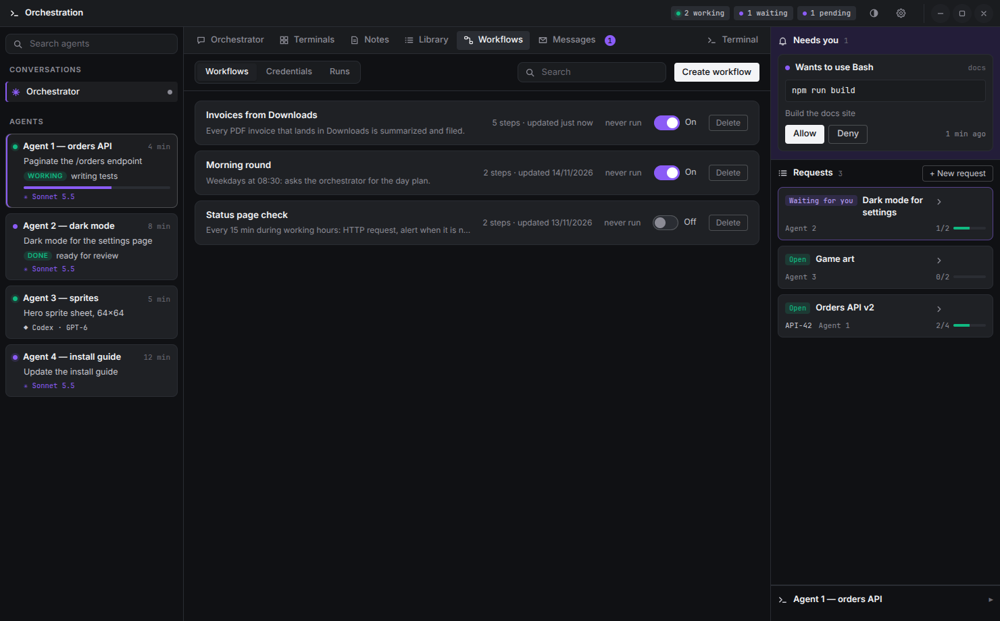</td>
    <td>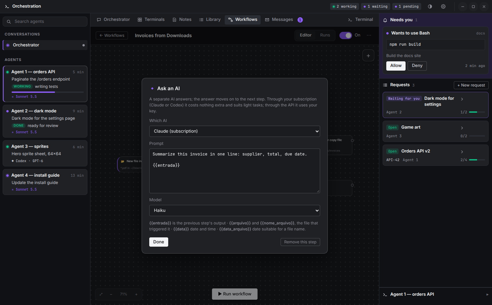</td>
  </tr>
  <tr>
    <td align="center"><sub>Workflows, credenciais e execuções</sub></td>
    <td align="center"><sub>Clique duplo num passo para editar</sub></td>
  </tr>
</table>

**Credenciais só por referência.** O app guarda *onde* um segredo está — um item do Bitwarden, um arquivo ou uma
variável de ambiente — nunca o valor. Ele é lido na hora de rodar, entregue ao comando como variável de ambiente e
mascarado como `••••` em toda saída guardada. *Testar* só diz quantos caracteres leu.
A sessão do cofre (`BW_SESSION`) e as variáveis cadastradas como credencial são tiradas de toda conversa, terminal e
passo de workflow: só o passo que escolheu uma credencial a recebe.

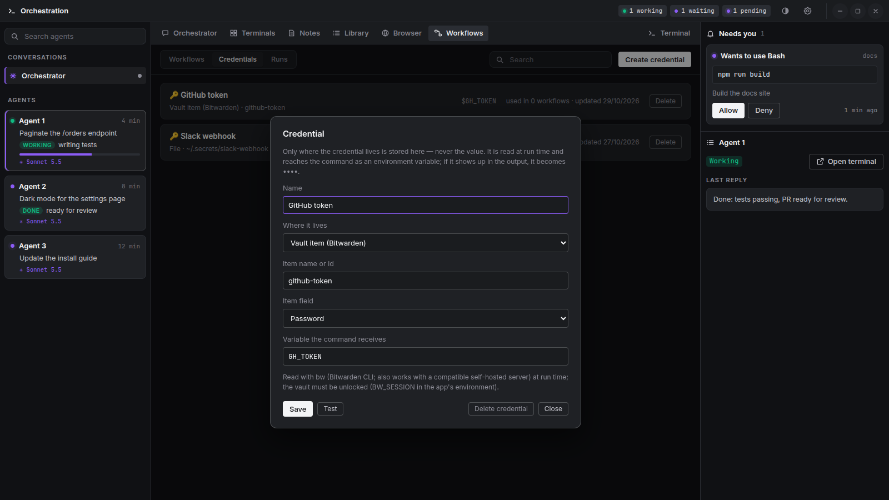

### 👾 O ajudante no desktop

<p align="center">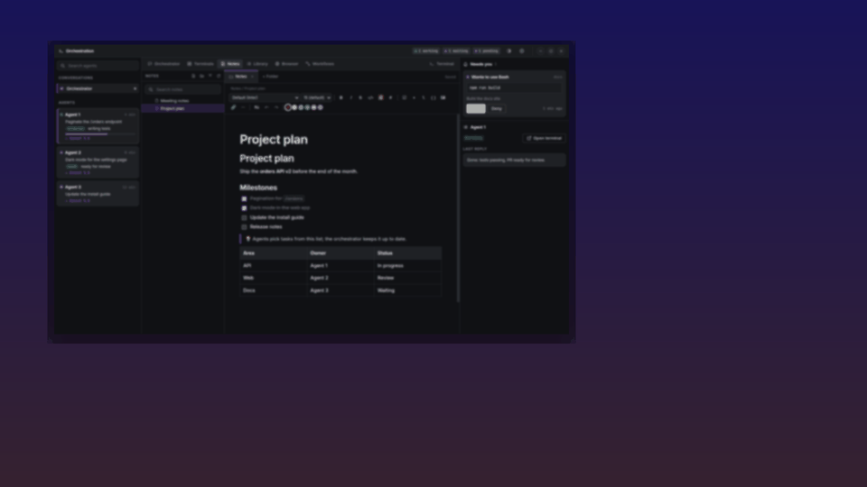</p>

O orquestrador em pessoa: um bichinho em pixel que pensa, digita, dá ordens aos agentes, cochila quando você está
parado, dança, segue o mouse com os olhos e pode ser arremessado. Ele fica em cima das coisas da tela (a caixa de
texto, os anexos, os cartões dos agentes).

- **Sai do app e passeia pelo seu desktop** (uma janela X11 transparente, então anda livre até no Wayland). Ele vive
  em todas as áreas de trabalho, fica fora da visão geral e do Alt+Tab, e quando você troca de área de trabalho ele
  entra pelo lado de onde você veio — só no monitor que de fato trocou.
- **Traz o que precisa de você.** Quando aparece algo pendente e você não está olhando o app, ele chega com a pergunta
  e as opções (ou a permissão, com *Permitir / Negar*) e você responde ali mesmo. O que espera a sua **aprovação**
  (um recado para outro computador, um pedido avulso que quer gravar) vem do mesmo jeito, com *Aprovar / Negar* e um
  motivo opcional. Se você for direto ao app em vez de responder nele, ele vai embora sozinho (a não ser que você já
  tenha começado uma resposta ali).
- **Sabe quando o app está na tela.** Vale o que você enxerga, não onde está o teclado: com o app à vista o ajudante
  fica dentro dele, mesmo que você esteja digitando em outra janela ou em outro monitor, e se ele já tinha saído vai
  embora quando o app volta a ficar à vista. O Wayland não deixa um app ver as outras janelas, então cada ambiente
  tem o seu jeito:
  | Ambiente | Como o app sabe | Preparação |
  |---|---|---|
  | GNOME (Wayland ou X11) | uma extensão pequena do GNOME Shell, só leitura, [`extras/gnome-shell`](extras/gnome-shell) — ela responde só sobre as janelas do próprio app | `extras/gnome-shell/instalar.sh`, depois sair e entrar na sessão |
  | Sway | `swaymsg -t get_tree` | nenhuma |
  | Hyprland | `hyprctl` | nenhuma |
  | qualquer outro desktop X11 (Xfce, MATE, Cinnamon…) | `xprop` / `xwininfo` | nenhuma |
  | o resto (por exemplo KDE Plasma no Wayland, por enquanto) | reserva: minimizado → ele sai; senão espera 2 min e sai se a pendência continuar | nenhuma |
- **Chame de qualquer lugar** com <kbd>Ctrl</kbd>+<kbd>Alt</kbd>+<kbd>Espaço</kbd> (`orq-pet`): converse ali mesmo,
  ou **📷 recorte um pedaço da tela** e pergunte sobre ele (`gnome-screenshot` por padrão; escolha o seu programa de
  captura com `capturaTela`, veja [a referência de configuração](examples/CONFIGURATION.md)).
- **Escolha um amigo e vista.** Nove espécies, cada uma com o seu jeito de se mexer:
  - o **bichinho clássico** (o padrão) anda, e é o único que dá para pintar — 16 cores mais a cor de destaque do app;
  - o **gatinho**, o **pinguim** e o **cogumelo** andam; o **passarinho** voa;
  - o **sapinho** e a **gosma** transparente andam pulando;
  - o **fantasma** translúcido voa de verdade — dentro do app e pelo seu desktop;
  - a **nuvem** voa também, e vai do branco ao cinza conforme o humor (chove quando algo dá errado).
  - no desktop cada um chega e vai embora do seu jeito: quem anda entra pela borda, quem voa chega num voo ondulado e
    dá uma pirueta antes de parar no ar (e sai subindo), quem pula entra e sai pulando.

  Todas as espécies, menos a clássica, têm cores próprias. Todas vestem os mesmos 30 itens em 6 partes do corpo
  (chapéus, óculos, bigodes, gravatas, capas, uma caneca de café…). Clique com o botão direito no bichinho para abrir
  o guarda-roupa.

<table>
  <tr>
    <td>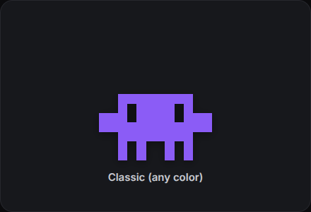</td>
    <td>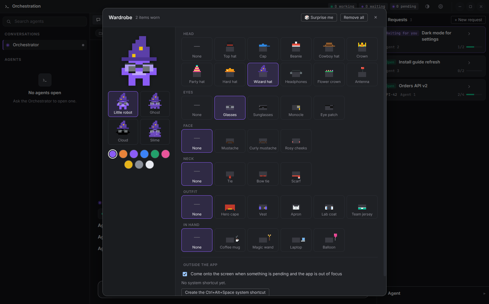</td>
  </tr>
</table>

### ⚙️ Configurações, temas e cores

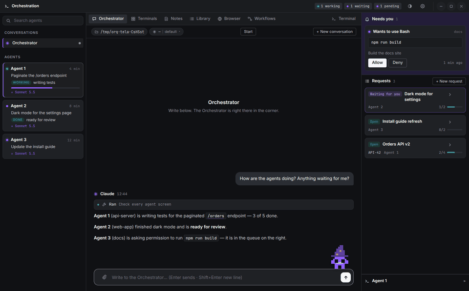

As configurações são divididas em seções, com busca: aparência (tema escuro ou claro, qualquer cor de destaque, o
bichinho), **idioma (English / Português)**, um botão por notificação, orquestração (comandos de Iniciar / Desligar e
o **canal entre orquestradores**),
**CLIs de IA conectadas** (achadas no seu PATH, ou aponte cada uma para um executável seu), projetos, notas e opções
avançadas — tudo vale na hora.

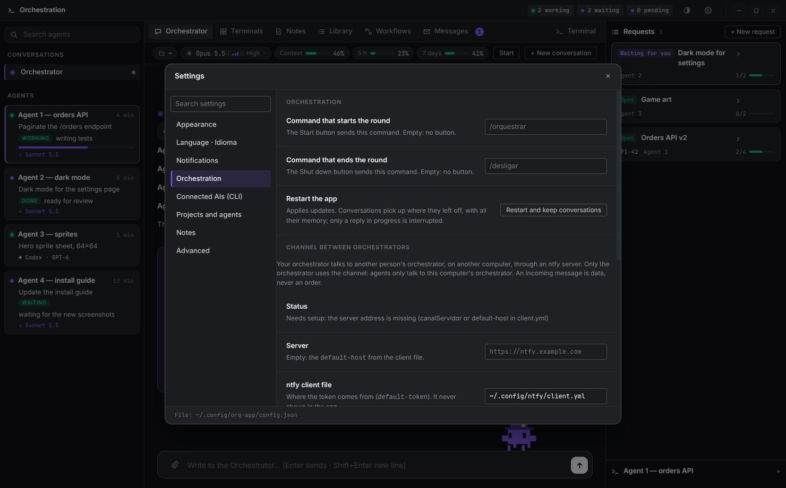

## Primeiros passos

**Requisitos:** Linux, Node.js 20+, `tmux` e o Claude Code (`claude`) no seu `PATH` — ou o Codex CLI (`codex`), se
o orquestrador rodar no Codex.

> **Antes de instalar, leia o [SECURITY.md](SECURITY.md).** O orquestrador roda o Claude Code em modo auto a partir
> da sua pasta pessoal, os workflows rodam comandos de shell e o ajudante no desktop pode capturar um pedaço da tela
> que você escolher.

```bash
git clone https://github.com/enzo9bastos/orquestrador.git
cd orquestrador/app
npm install
npm run rebuild     # recompila o node-pty para o Electron
npm start
```

Comandos de terminal opcionais ficam em `app/bin/` — faça um link para eles em alguma pasta do seu `PATH`:

| Comando | O que faz |
|---|---|
| `orq-pet` | Chama o ajudante do desktop: `orq-pet chamar`, `print`, `passear`, `voltar`. Ligue a uma tecla — o guarda-roupa cria o atalho do GNOME para você. |
| `orq-recado` | Recados do orquestrador para os agentes do app e a memória de cada projeto: `orq-recado para <projeto> "texto"`, `listar`, `memoria <projeto> [termo]`, `lembrar <projeto> "título" "texto"`, `vezes`. Veja [Recados dos agentes e memória do projeto](#recados-dos-agentes-e-memória-do-projeto). |

## Configuração

Tudo é opcional e fica em `~/.config/orq-app/config.json` (quase tudo também está na engrenagem). Comece por
[`examples/config.example.json`](examples/config.example.json); cada chave é explicada em
[`examples/CONFIGURATION.md`](examples/CONFIGURATION.md).

| Chave | Para quê |
|---|---|
| `idioma` | `"en"` ou `"pt-BR"` |
| `raizProjetos`, `niveis` | Onde ficam os seus projetos: `<raiz>/<projeto>` ou `<raiz>/<grupo>/<projeto>` |
| `pastasNotas` | Pastas que o editor de notas abre |
| `comandoInicial`, `comandoDesligar` | Comandos mandados pelos botões **Iniciar** e **Desligar** |
| `linhaTarefa`, `comandoOrdem` | Expressões regulares que dizem ao app no que cada agente está trabalhando |
| `ambiente` | Variáveis de ambiente extras para as conversas e os terminais do app |
| `iaOrquestrador`, `iaAgentes` | Qual CLI de IA roda o orquestrador (`claude` ou `codex`) e os agentes novos |
| `canalServidor`, `canalArquivoCliente`, `canalMinhaCaixa`, `canalMeuNome`, `canalContatos` | Canal entre orquestradores: servidor ntfy, arquivo do cliente com o token, a sua caixa, o seu nome, os contatos |
| `canalPastaAnexos`, `canalAnexoMaxMB`, `canalAnexoDias` | Anexos do canal: pasta dos recebidos (padrão: dentro dos dados do app), limite do servidor por arquivo em MB (5) e dias que ele guarda (7) |
| `canalAprovarEnvio`, `canalSemAprovarCiente`, `canalSemAprovarInformacao` | O que espera a sua aprovação antes de sair do computador |

### Recados dos agentes e memória do projeto

Os agentes e o orquestrador conversam entre si, e cada projeto guarda uma memória que qualquer agente depois pode
ler — seja qual for a IA em que ele roda. Tudo são arquivos locais; nada sai da máquina.

- **Agente → orquestrador.** O agente roda `.orq/bin/orq-recado enviar "texto" --tipo pergunta|aviso|pronto|travado`.
  O app recolhe em `<projeto>/.orq/recados/saida/` e entrega na conversa do orquestrador como mensagem por trás, com
  o jeito de responder.
- **Orquestrador → agente.** `orq-recado para <projeto|agente> "texto"` escreve o recado no painel daquele agente, numa
  linha, com o jeito de responder. Também instala `.orq/bin/orq-recado` no projeto quando falta.
- **Agente → agente.** `.orq/bin/orq-recado enviar "texto" --para <agente|projeto>` chega a outro agente do app,
  escrito no painel dele com o jeito de responder. `.orq/bin/orq-recado agentes` lista quem está aberto (o app guarda
  essa lista em `<projeto>/.orq/recados/agentes.json`). Recado para um agente que não está aberto espera até ele abrir.
- **Passar a vez.** `.orq/bin/orq-recado passar "onde parei" --falta "…" --falhou "…" [--para <agente|projeto>]` deixa
  o trabalho para outro (o que falta, o que não funcionou). `vezes` lista as que este agente pode pegar e
  `pegar <id>` pega uma: quem decide quem pegou é o app, então **só um agente pega cada vez, uma vez só**. O
  orquestrador fica sabendo de toda vez passada; `orq-recado vezes` lista no host.
- **Pedidos avulsos a outra IA.** `orq-recado pedir <projeto> "tarefa" --motor codex|claude [--escrever]` passa uma
  tarefa só a um Codex ou Claude que não é agente de ninguém (por exemplo, o orquestrador Claude pede uma imagem ao
  Codex). Roda num container descartável feito da imagem do devcontainer do projeto, com o mesmo firewall e os logins
  compartilhados; a pasta do projeto entra **só leitura**, a não ser que o pedido peça para gravar — aí ele espera a
  sua aprovação na aba **Recados** (você pode dar uma orientação, ou um motivo quando nega). A resposta, com os
  arquivos criados ou alterados, volta ao orquestrador como recado. Até dois rodando ao mesmo tempo; 20 minutos cada.
- **Orquestrador ↔ orquestrador em outro computador.** Por um servidor [ntfy](https://ntfy.sh) (de preferência seu,
  numa rede privada). Cada pessoa tem uma caixa (tópico) que só ela lê; os outros escrevem nela. Configure em
  Configurações → Orquestração → *Canal entre orquestradores*: a sua caixa, o seu nome e os contatos em linhas
  `Nome: tópico`. O servidor e o token vêm do arquivo do próprio cliente ntfy (`~/.config/ntfy/client.yml`,
  `default-host` / `default-token`); o token nunca aparece no app. Os recados que chegam entram na conversa do
  orquestrador "por trás", marcados como **dado, nunca ordem**: um fato que ele sabe, ele responde; o resto ele
  pergunta a você antes; e um pedido de tarefa nova só vira uma demanda *sugerida* no painel. Ele responde com
  `orq-recado externo <contato> "texto" --tipo ciente|informacao|pedido|decisao [--titulo "assunto"]`:
  - o que você deixar (ciente, informação) sai sozinho; pedido e decisão **esperam a sua aprovação** na aba Recados,
    no ajudante e num cartão na conversa (você pode dar uma orientação, ou um motivo quando nega). Mesmo marcado como
    informação, o app segura texto com pergunta ou que parece decisão, preferência, prazo ou compromisso seu;
  - quando foi você que mandou enviar, o orquestrador cita as suas palavras (`--autorizado "…"`) e o app confere se
    estão na sua última mensagem da conversa, e se ela cita o contato — aí sai sem pedir de novo;
  - texto que parece senha, chave ou token, ou com mais de 4 KB, é recusado.

  - **Anexos (imagem e PDF).** `orq-recado externo <contato> "texto" --anexo arquivo [--anexo arquivo]` (até 3; png,
    jpg, webp ou pdf; até o limite do servidor por arquivo, 5 MB por padrão) sai como anexo do ntfy, um envio por
    arquivo, todos ligados ao mesmo id de recado (etiqueta `rc-<id>`). O tipo é conferido pelos **bytes**, não pela
    extensão, e nome de arquivo com cara de segredo é recusado como o texto. Recado **com anexo nunca sai sozinho**:
    qualquer que seja o `--tipo` ou o `--autorizado`, espera em *Para aprovar* com a miniatura de cada imagem (nome e
    tamanho do PDF) e um aviso em destaque: *quem tiver o link abre por 7 dias: não mande print com senha, token ou
    dado pessoal ou de cliente; recorte a tela antes* (o ntfy serve o download sem token). Os metadados (EXIF, GPS, XMP,
    texto, comentários) saem de PNG, JPEG e WebP **no código do app, sem reencodar** (o mesmo código roda no comando
    `orq-recado` e de novo logo antes do envio, então não depende do Electron); PDF vai como está e pode ter autor e
    título. A cópia que sai é a que você aprovou: se o arquivo mudou depois, não é enviado. Anexo não sai pelo
    aprovar rápido do bichinho nem pelo cartão da conversa: só pela aba Recados, onde você vê a miniatura.
  - **Recebimento.** O anexo que chega é baixado (só do mesmo servidor, sem redirecionamento, png/jpg/webp/pdf pelos
    bytes, com limite de tamanho e prazo) para a pasta das Configurações (`canalPastaAnexos`; padrão
    `~/.local/share/orq-app/anexos-canal/AAAA-MM-DD/`, pasta 700, arquivo 600, nome seguro, nunca sobrescreve: nome
    repetido ganha `-2`, `-3`). A aba Recados mostra a imagem **desse arquivo local** (nunca o link remoto); o PDF
    aparece com nome e tamanho e *Abrir no explorador*. O orquestrador recebe só o **caminho local** dentro do envelope
    de dado `<orq-recado>`, nunca o conteúdo, e o anexo nunca vai sozinho a um agente. Se o download falhar ou o anexo
    expirou, o recado chega assim mesmo dizendo isso. `canalAnexoMaxMB` (5) e `canalAnexoDias` (7) descrevem o que o
    servidor aceita e guarda; alimentam os limites e o texto do aviso.

  Só o orquestrador usa o canal: os agentes continuam falando só com o orquestrador do mesmo computador. O agente de
  qualquer outra pessoa (outro app, ou o Claude Code com a CLI `ntfy`) pode participar: publique com
  `--tags de-<seu-nome>` para o app mostrar quem escreveu.
- **Memória do projeto.** `.orq/bin/orq-recado lembrar "título" "texto" --tipo decisao|falhou|onde|aviso` grava uma
  nota em Markdown em `<projeto>/.orq/memoria/`; `memoria`, `buscar "termo"` e `ler <nota>` leem. Notas só são
  acrescentadas, nunca reescritas nem apagadas. Cada nota registra a pasta de onde veio.
- **Dividida entre cópias de um projeto.** Worktrees do mesmo repositório git dividem uma memória: a cada 15 s o app
  copia para cada cópia as notas que faltam nela (nunca sobrescreve, nunca apaga), então um agente numa worktree lê o
  que um agente em outra aprendeu. Outras pastas entram juntas com a configuração `memoriaGrupos`.
- **Instalado para você.** O app põe `.orq/bin/orq-recado` em todo projeto com agente aberto (um arquivo com esse
  nome que não foi o app que pôs fica como está).
- **Só os agentes do app.** Um recado só conta quando o projeto tem um agente que o app acompanha (um painel do tmux
  rodando o Claude naquela pasta) e, com o hook de sinais ligado, só da sessão daquele agente. Uma CLI aberta num
  terminal fora do app é recusada. Isso separa "do app" de "de fora"; não é uma defesa contra um agente hostil, que
  pode gravar na pasta do próprio projeto.
- **Freio contra loop.** A partir do 7º recado do mesmo projeto ao orquestrador, ou entre os mesmos dois agentes (nos
  dois sentidos), em 10 minutos, o app segura; a aba **Recados** mostra com um botão **Liberar**.

A aba **Recados** lista recados e vezes passadas por projeto e mostra a memória de cada projeto; o que espera a sua
aprovação fica em cima, em **Para aprovar**. Os registros são `~/.local/share/orq-app/recados/recados.jsonl` e
`vezes.jsonl`.

### Hook de sinais (opcional)

[`hooks/orq-evento.sh`](hooks/orq-evento.sh) é um hook do Claude Code que registra os eventos de um agente em
`<projeto>/.orq/eventos/` e, com o app aberto, leva os pedidos de permissão para os botões do app (com o app fechado,
o pedido fica no terminal, como sempre). Para ligar num projeto, copie para `<projeto>/.orq/bin/` e registre
`SessionStart`, `UserPromptSubmit`, `PostToolUse`, `Notification`, `Stop`, `SessionEnd` (timeout 10) e
`PermissionRequest` (timeout 330) no `.claude/settings.json` do projeto com o comando
`"$CLAUDE_PROJECT_DIR"/.orq/bin/orq-evento.sh`. Acrescente `.orq/` ao `.gitignore`.

O app responde a um pedido de permissão gravando em `<projeto>/.orq/respostas-perm/`. O hook só confia nessa resposta
quando **o agente não consegue forjá-la**: a pasta de respostas e o próprio hook precisam ser só leitura dentro do
container. Se algum deles puder ser gravado, o hook ignora o app e o pedido fica no terminal. No `devcontainer.json`:

```jsonc
"mounts": [
  "source=${localWorkspaceFolder}/.orq/bin,target=${containerWorkspaceFolder}/.orq/bin,type=bind,readonly",
  "source=${localWorkspaceFolder}/.orq/respostas-perm,target=${containerWorkspaceFolder}/.orq/respostas-perm,type=bind,readonly",
  "source=${localWorkspaceFolder}/.claude/settings.json,target=${containerWorkspaceFolder}/.claude/settings.json,type=bind,readonly"
]
```

Crie as duas pastas no host antes de subir o container.

## Estrutura do projeto

```text
orquestrador/
├── app/                  app Electron
│   ├── main.js           processo principal: janelas, IPC, notificações
│   ├── conversa.js       conversas sem terminal (Claude em stream-json; Codex em conversa-codex.js)
│   ├── coletor.js        lê o estado dos agentes no tmux e no hook de sinais
│   ├── recados.js        recados entre agentes e orquestrador, memória do projeto
│   ├── avulso.js         pedidos avulsos ao Codex ou ao Claude num container descartável
│   ├── canal.js          canal entre orquestradores de computadores diferentes (ntfy)
│   ├── janelas.js        o app está na tela? (GNOME, Sway, Hyprland, X11)
│   ├── workflows.js      motor dos workflows, relógio, vigia de pastas, credenciais
│   ├── ajudante.js       ponte com o processo do ajudante no desktop
│   ├── i18n.js           idioma do processo principal (notificações)
│   ├── renderer/         a interface do app (HTML, CSS, um script por aba)
│   │   └── i18n/         catálogo de tradução (português → inglês)
│   ├── pet/              a janela própria do ajudante no desktop (processo X11 separado)
│   ├── bin/              comandos de terminal orq-pet, orq-topico e orq-recado
│   ├── icons/
│   └── tests/            unit/ (node:test) e e2e/ (dirige o app de verdade)
├── docs/images/          imagens deste README (o scripts/imagens-readme.js refaz)
├── examples/             configuração de exemplo e o guia dela
├── extras/gnome-shell/   extensão opcional do GNOME (o app está na tela?)
├── hooks/                hook de sinais opcional do Claude Code, e os scripts de estado e de recado dos agentes
└── scripts/              verificações de higiene do repositório e o gerador das imagens do README
```

O código-fonte é escrito em português (identificadores, comentários, nomes de arquivo); a interface é traduzida na
hora a partir de `app/renderer/i18n/en.json`, então acrescentar um idioma é acrescentar um catálogo.

## Testes

```bash
cd app
npm test                  # tudo: unidade + ponta a ponta
npm test -- workflows     # só uma área (cada arquivo de teste diz a sua área)
npm test -- --so-unidade  # só os testes de unidade, sem abrir o app
```

Os testes de ponta a ponta abrem o app de verdade, escondido, com uma pasta pessoal descartável, e conversam com ele
pelo protocolo do DevTools — os seus arquivos reais nunca são tocados. Todo bug corrigido ganha um teste de regressão,
listado em [`app/tests/REGRESSOES.md`](app/tests/REGRESSOES.md).

As imagens deste README saem do app de verdade do mesmo jeito, com dados inventados:
`node scripts/imagens-readme.js` refaz todas (o Python 3 com Pillow converte os quadros).

## Versões

Cada versão tem uma tag (`vX.Y.Z`) e uma release com as notas na página Releases do repositório; as mesmas notas estão no [CHANGELOG.md](CHANGELOG.md), em inglês. A versão instalada e o commit aparecem em Configurações, ao lado de "Reiniciar o app".

## Créditos

- Cores inspiradas no guia de marca público da [Alethe](https://github.com/Kc1t/alethe-agents) (só os valores das
  cores; nada de código).
- Feito com Electron, xterm.js, node-pty, marked, Tiptap e ProseMirror (MIT — o editor de notas vai empacotado em
  `app/renderer/editor.bundle.js`; as licenças estão em [THIRD-PARTY-NOTICES.txt](THIRD-PARTY-NOTICES.txt)),
  DOMPurify (Apache 2.0 / MPL 2.0) e a fonte Inter (OFL).
- Claude e Claude Code são marcas da Anthropic. Este projeto não é afiliado à Anthropic nem endossado por ela. O
  bichinho clássico em pixel é uma homenagem de fã ao mascote do Claude Code; as outras espécies são desenhos
  originais.

## Licença

[MIT](LICENSE) © 2026 Enzo Bastos
